# FERROSTATS — Data Lakehouse Medallón en Google Cloud (BigQuery + Dataform SQLX) y Pipeline de Ingesta Streaming

<p align="center">
  
</p>

<p align="center">
  <strong>Proyecto de Portafolio de Ingeniería de Datos: Data Lakehouse Medallón Automatizado (Bronze / Silver / Gold) en Google BigQuery, Orquestación Declarativa SQLX con Google Dataform, Modelado Analítico con Funciones de Ventana (Pareto 80/20, DOI, ROP) y Gobernanza FinOps de $0.00/mes.</strong>
</p>

<p align="center">
  <a href="https://www.credly.com/badges/e27fea72-5eaf-47ee-a43c-43faa3a8fb10"></a>
  <a href="https://cloud.google.com/bigquery"></a>
  <a href="https://cloud.google.com/dataform"></a>
  <a href="https://lookerstudio.google.com/"></a>
  <a href="finops/gcp_free_tier_policy.json"></a>
  <a href="https://www.python.org/"></a>
</p>

<p align="center">
  <strong>Idioma / Language:</strong> <strong>Español</strong> | <a href="README.md">English Version</a>
</p>

> [!IMPORTANT]
> **Enfoque 100 % en Ingeniería de Datos y Rol del Simulador Web:**  
> Este repositorio es un proyecto de **Ingeniería de Datos y Arquitectura Cloud**. Los entregables centrales son el **Data Lakehouse Medallón en Google BigQuery (`ferrostats_bronze` $\to$ `ferrostats_silver` $\to$ `ferrostats_gold`)**, el **pipeline declarativo en Google Dataform SQLX con aserciones de Calidad de Datos**, las **funciones analíticas de ventana en SQL (Pareto 80/20, Burn Rate, DOI, ROP)** y la **arquitectura FinOps de $0.00/mes en GCP**.  
> Dado que un pipeline de ingesta en streaming requiere una fuente transaccional de origen, se generó un simulador web ligero (`/pos` y `/`) mediante **Spec-Driven Development (SDD)** exclusivamente para actuar como **productor sintético de eventos OLTP** hacia BigQuery Bronze.

---

## Recursos de la Plataforma de Datos en Vivo

| Capa de la Plataforma de Datos | Recurso / Enlace en Vivo | Alcance Técnico |
|---|---|---|
| **1. Capa Analítica BI (Looker Studio)** | [**Reporte Ejecutivo Oficial de 3 Páginas en Looker Studio**](https://datastudio.google.com/reporting/2389e684-fc9b-431d-9c56-487b3067eb87/page/p_dwbfqrtk8d) | Conectado nativamente a los Data Marts en Esquema Estrella de BigQuery Gold (`fct_daily_sales`, `mart_inventory_pareto_abc`, `dim_products`). |
| **2. Cloud Data Lakehouse (GCP)** | **Proyecto:** `ferrostats` (`US` / `us-central1`)<br>**Repo Dataform:** `ferrostats-pipeline` (`main-workspace`) | **Bronze:** 7 tablas crudas inmutables<br>**Silver:** 3 vistas curadas SQLX + aserciones DQ<br>**Gold:** 3 tablas analíticas en Esquema Estrella |
| **3. Productor de Eventos OLTP (Cloud Run)** | [**Simulador de Transacciones POS (`/pos`)**](https://ferrostats-bi-platform-s72yk4nsvq-uc.a.run.app/pos) • [**Monitor de Inventario y ROP (`/`)**](https://ferrostats-bi-platform-s72yk4nsvq-uc.a.run.app) | Simulador de ingesta en el borde (`<50 ms` ACID SQLite WAL + idempotencia UUID) que transmite eventos hacia `ferrostats_bronze`. |

---

## 1. Arquitectura y Linaje de Datos (OLTP Edge $\to$ BigQuery Medallion $\to$ BI)

```mermaid
flowchart TD
    subgraph SOURCE["1. Productor de Eventos OLTP en el Borde (Cloud Run — $0.00/mes)"]
        SIM["Productor Sintético de Eventos Retail (/pos y /)\n- Semilla Determinista (180 Ventas, 30 SKUs)\n- Bloqueo SQLite WAL BEGIN IMMEDIATE (<50 ms)\n- Descuento Atómico de Stock e Idempotencia UUID"]
        STREAM["Cliente Asíncrono de Ingesta REST (bigquery_sync.py)\n- Tokens OAuth2 vía Servidor Interno de Metadatos GCP\n- Cero SDKs Pesados (urllib.request estándar)"]
    end

    subgraph LAKEHOUSE["2. Google BigQuery Medallion Data Lakehouse ($0.00/mes Free Tier)"]
        subgraph BRONZE["Capa Bronze (ferrostats_bronze — 7 Tablas Crudas Inmutables)"]
            B1["raw_sales (180+ ventas)\nraw_sale_items (271+ líneas)"]
            B2["raw_products (30 SKUs)\nraw_categories (6) y raw_suppliers (6)"]
            B3["raw_inventory_movements (294+ logs)\nraw_users (4)"]
        end

        subgraph SILVER["Capa Silver (ferrostats_silver — 3 Vistas Dataform SQLX y Assertions)"]
            S1["stg_sales\n- SAFE.PARSE_TIMESTAMP\n- Deduplicación QUALIFY ROW_NUMBER()\n- Assertions: uniqueKey, nonNull, total >= 0"]
            S2["stg_sale_items\n- Cálculo de COGS Histórico y Utilidad por Línea\n- Deduplicación QUALIFY ROW_NUMBER()\n- Assertions: quantity > 0, subtotal >= 0"]
            S3["stg_products\n- Catálogo Enriquecido + Lead Time\n- Enum canónico stock_status (OPTIMAL, LOW_STOCK, OUT_OF_STOCK)\n- Assertions: price >= cost, stock >= 0"]
        end

        subgraph GOLD["Capa Gold (ferrostats_gold — 3 Data Marts Materializados en Esquema Estrella)"]
            G1["fct_daily_sales\nGranularidad diaria por (date_key, category_code)\nIngresos Brutos, COGS, Utilidad y Margen %"]
            G2["mart_inventory_pareto_abc\nFunciones de Ventana Móvil 30d:\nClase ABC 80/20, Burn Rate, DOI y ROP"]
            G3["dim_products\nDimensión Conformada SKU-a-Nombre\nMárgenes Unitarios, Proveedores y Pasillos"]
        end
    end

    subgraph BI["3. Capa de Business Intelligence y Consumo"]
        LOOKER["Google Looker Studio (Dashboard Ejecutivo de 3 Páginas)\n- Página 1: Evolución de Ingresos, COGS y Margen Bruto\n- Página 2: Matriz Pareto 80/20, Burn Rate y Prioridad de Reorden\n- Página 3: Valoración de Capital de Trabajo por Clase ABC"]
    end

    SIM -->|Evento Confirmado| STREAM
    STREAM -->|tabledata.insertAll| BRONZE
    BRONZE -->|Compilación Dataform SQLX| SILVER
    SILVER -->|Materialización Star Schema| GOLD
    GOLD -->|Conector Nativo BigQuery| LOOKER
```

<p align="center">
  
</p>



---

## 2. Ingeniería del Data Lakehouse Medallón en Google BigQuery y Dataform

El núcleo del proyecto reside en [`dataform/`](dataform/) y [`app/etl/`](app/etl/), implementando una arquitectura Medallón de tres capas orquestada mediante **SQLX** declarativo:

### 2.1 Desglose de Capas (`Bronze` $\to$ `Silver` $\to$ `Gold`)

| Capa | Dataset en BigQuery | Objeto y Tipo | Granularidad y Transformaciones | Aserciones de Calidad (`ferrostats_assertions`) |
|---|---|---|---|---|
| **Bronze** | `ferrostats_bronze` | `raw_sales`<br>`raw_sale_items`<br>`raw_products`<br>`raw_categories`<br>`raw_suppliers`<br>`raw_inventory_movements`<br>`raw_users`<br>*(7 Tablas Crudas)* | Tablas de aterrizaje *append-only* pobladas vía streaming REST ([`bigquery_sync.py`](app/etl/bigquery_sync.py)) y carga por lotes ([`sync_sqlite_to_bigquery.py`](scripts/sync_sqlite_to_bigquery.py)). Preserva *snapshots* históricos de costo y precio. | Validación de esquema en la ingesta. |
| **Silver** | `ferrostats_silver` | [`stg_sales.sqlx`](dataform/definitions/silver/stg_sales.sqlx)<br>*(Vista)* | 1 fila por `sale_id`. Casteo de tipos (`INT64`, `FLOAT64`, `TIMESTAMP`), extracción de `date_key`, cálculo de margen neto y deduplicación de streaming vía `QUALIFY ROW_NUMBER() OVER (PARTITION BY sale_id ORDER BY sale_timestamp DESC) = 1`. | `uniqueKey: ["sale_id"]`<br>`nonNull: ["sale_id", "transaction_uuid", "sale_timestamp", "total_amount_usd"]`<br>`rowConditions: ["total_amount_usd >= 0", "total_cost_usd >= 0"]` |
| **Silver** | `ferrostats_silver` | [`stg_sale_items.sqlx`](dataform/definitions/silver/stg_sale_items.sqlx)<br>*(Vista)* | 1 fila por `sale_item_id`. Calcula el COGS histórico por línea (`quantity * unit_cost_snapshot_usd`) y la utilidad bruta (`subtotal_usd - item_cogs_usd`) con deduplicación `QUALIFY ROW_NUMBER()`. | `uniqueKey: ["sale_item_id"]`<br>`nonNull: ["sale_item_id", "sale_id", "product_id", "quantity"]`<br>`rowConditions: ["quantity > 0", "subtotal_usd >= 0"]` |
| **Silver** | `ferrostats_silver` | [`stg_products.sqlx`](dataform/definitions/silver/stg_products.sqlx)<br>*(Vista)* | 1 fila por `product_id`. Cruza `raw_products` con `raw_categories` y `raw_suppliers` deduplicados, calcula el margen unitario y estandariza `stock_status` (`OUT_OF_STOCK`, `LOW_STOCK`, `OPTIMAL`). | `uniqueKey: ["product_id"]`<br>`nonNull: ["product_id", "sku", "product_name", "unit_cost_usd", "unit_price_usd"]`<br>`rowConditions: ["unit_cost_usd > 0", "unit_price_usd >= unit_cost_usd", "current_stock >= 0"]` |
| **Gold** | `ferrostats_gold` | [`fct_daily_sales.sqlx`](dataform/definitions/gold/fct_daily_sales.sqlx)<br>*(Tabla)* | 1 fila por `(date_key, category_code)`. Pre-agrega transacciones diarias, unidades vendidas, `gross_revenue_usd`, `cogs_usd`, `gross_profit_usd` y `gross_margin_pct` para consultas en sub-segundos desde Looker Studio. | `uniqueKey: ["date_key", "category_code"]`<br>`nonNull: ["date_key", "category_code", "gross_revenue_usd"]` |
| **Gold** | `ferrostats_gold` | [`mart_inventory_pareto_abc.sqlx`](dataform/definitions/gold/mart_inventory_pareto_abc.sqlx)<br>*(Tabla)* | 1 fila por `product_id`. Calcula ingresos móviles de 30 días, porcentaje acumulado de Pareto (`abc_class` `A`/`B`/`C`), `daily_burn_rate`, `days_of_inventory_left` (DOI), `recommended_reorder_qty` (ROP) y valoración de inventario a costo/retail. | `uniqueKey: ["product_id"]`<br>`nonNull: ["product_id", "sku", "abc_class", "stock_status"]` |
| **Gold** | `ferrostats_gold` | [`dim_products.sqlx`](dataform/definitions/gold/dim_products.sqlx)<br>*(Tabla)* | 1 fila por `product_id`. Dimensión conformada de catálogo que traduce llaves de negocio `sku` a `product_name`, `category_name`, `supplier_name`, `aisle_location` y `catalog_margin_pct`. | `uniqueKey: ["product_id"]`<br>`nonNull: ["sku", "product_name", "category_name"]` |

---

## 3. SQL Analítico: Funciones de Ventana Pareto 80/20, DOI y Punto de Reorden (ROP)

En [`dataform/definitions/gold/mart_inventory_pareto_abc.sqlx`](dataform/definitions/gold/mart_inventory_pareto_abc.sqlx), los indicadores de cadena de suministro se calculan dinámicamente en BigQuery sin umbrales estáticos:

### 3.1 Ventana Acumulativa Monotónica de Ingresos (`ROWS BETWEEN UNBOUNDED PRECEDING AND CURRENT ROW`)
```sql
WITH pareto_calc AS (
  SELECT
    b.*,
    SUM(b.revenue_30d_usd) OVER() AS total_revenue_all,
    SUM(b.revenue_30d_usd) OVER(
      ORDER BY b.revenue_30d_usd DESC, b.units_sold_30d DESC, b.product_id ASC
      ROWS BETWEEN UNBOUNDED PRECEDING AND CURRENT ROW
    ) AS running_revenue
  FROM
    products_base b
),
pareto_enriched AS (
  SELECT
    pc.*,
    ROUND(SAFE_DIVIDE(pc.running_revenue, NULLIF(pc.total_revenue_all, 0)) * 100.0, 2) AS cumulative_rev_pct,
    ROUND(pc.units_sold_30d / 30.0, 3) AS daily_burn_rate
  FROM
    pareto_calc pc
)
SELECT
  product_id, sku, product_name, category_name, aisle_location,
  current_stock, min_stock, stock_status,
  cumulative_rev_pct,
  CASE
    WHEN cumulative_rev_pct <= 80.0 THEN 'A'
    WHEN cumulative_rev_pct <= 95.0 THEN 'B'
    ELSE 'C'
  END AS abc_class
FROM pareto_enriched;
```
> **¿Por qué `ROWS BETWEEN UNBOUNDED PRECEDING AND CURRENT ROW` con desempate determinista?**  
> En BigQuery Standard SQL, un `ORDER BY` dentro de `SUM() OVER()` utiliza por defecto el marco `RANGE`, el cual agrupa valores empatados de facturación en un solo salto acumulado. Especificar explícitamente `ROWS` junto con un criterio de desempate determinista (`units_sold_30d DESC, product_id ASC`) garantiza una curva acumulada estrictamente monotónica fila por fila a lo largo de los 30 SKUs.

### 3.2 Burn Rate, Días de Inventario (DOI) y Punto de Reorden con Lead Time (ROP)
$$\text{Daily Burn Rate} = \frac{\text{Units Sold (30d)}}{30.0}, \qquad \text{DOI (Días)} = \frac{\text{Current Stock}}{\text{Daily Burn Rate}}$$

$$\text{Recommended Reorder Qty} = \max\Big(\text{Min Stock} + \lceil\text{Burn Rate} \times \text{Lead Time}\rceil + \lceil\text{Burn Rate} \times 15\rceil - \text{Current Stock},\; \text{Min Stock},\; 5\Big)$$

Cuando `current_stock <= min_stock`, la fórmula dimensiona automáticamente el pedido de reposición para cubrir el umbral mínimo, la demanda proyectada durante el tiempo de entrega del proveedor (`lead_time_days`) y un **colchón de seguridad de 15 días**.

---

## 4. Integridad de Ingesta OLTP-a-OLAP, Gobernanza FinOps ($0.00/mes) y Decisiones Arquitectónicas (ADR)

### 4.1 Concurrencia en el Borde e Idempotencia ([`app/api/routes_pos.py`](app/api/routes_pos.py))
- **Serialización Inmediata de Escritura (`BEGIN IMMEDIATE`):** Previene bloqueos `SQLITE_BUSY` al adquirir el candado de escritura desde el inicio de la transacción.
- **Descuento Atómico Protegido (`0%` Sobreventa):**
  ```sql
  UPDATE products
  SET current_stock = current_stock - ?, updated_at = ?
  WHERE product_id = ? AND current_stock >= ?;
  ```
  Si `cursor.rowcount == 0`, la transacción ejecuta un `ROLLBACK` inmediato y devuelve `HTTP 409 Conflict`.
- **Idempotencia por UUID (`transaction_uuid`):** Cada venta requiere un `transaction_uuid` único generado por el cliente. Si ocurre un reintento de red con el mismo UUID, el servidor responde `HTTP 200 OK` con `Idempotent-Replay: true` sin descontar stock dos veces ni duplicar eventos hacia BigQuery.

### 4.2 Arquitectura FinOps Permanente de $0.00 USD/Mes en GCP ([`finops/gcp_free_tier_policy.json`](finops/gcp_free_tier_policy.json))
Al reemplazar instancias persistentes de Cloud SQL (~$25/mes) y Serverless VPC Connectors (~$15/mes) por contenedores *scale-to-zero* en Cloud Run, tokens OAuth del servidor de metadatos y el Free Tier de BigQuery, la plataforma ahorra **~$40/mes** y opera permanentemente a **$0.00/mes**:

| Servicio de GCP | Límite Always Free Tier | Huella de FERROSTATS | Costo Facturado |
|---|---|---|:---:|
| **Google BigQuery** | 10 GB almacenamiento + 1 TB escaneo / mes | < 50 MB almacenamiento + < 25 MB escaneo / mes (tablas Gold pre-agregadas) | **$0.00 USD** |
| **Google Dataform** | Repositorios y workspaces SQLX gratuitos | 1 repositorio (`ferrostats-pipeline`) | **$0.00 USD** |
| **Google Looker Studio** | Reportes BI y conector nativo gratuitos | Dashboard de 3 páginas conectado a `ferrostats_gold` | **$0.00 USD** |
| **Google Cloud Run** | 2M peticiones + 360,000 vCPU-seg / mes | ~15,000 req/mes (`--min-instances 0`, `<3 s` arranque en frío) | **$0.00 USD** |
| **Google Artifact Registry** | 0.5 GB almacenamiento de contenedores / mes | Mantenido `< 0.3 GB` mediante poda automática de *digests* en `deploy_gcp.ps1` | **$0.00 USD** |
| **Cloud SQL y VPC Connectors** | *Prohibidos (Facturación fija por hora)* | Reemplazados por SQLite WAL en el borde + streaming REST con IAM metadata | **$0.00 USD** |

### 4.3 Decisiones Arquitectónicas Clave y Trade-offs de Ingeniería (ADR)

| Decisión de Ingeniería | Problema / Restricción Técnica | Solución Implementada | Beneficio y Ruta de Evolución Productiva |
|---|---|---|---|
| **ADR-01: Bronze Append-Only + `QUALIFY ROW_NUMBER()` en Silver** | El *streaming buffer* de `tabledata.insertAll` en BigQuery bloquea operaciones `UPDATE`/`DELETE` hasta por 90 minutos y opera bajo entrega *at-least-once* (posibles duplicados en reintentos). | Mantener `ferrostats_bronze` estrictamente inmutable (*append-only*) y deduplicar en las vistas de `ferrostats_silver` mediante `QUALIFY ROW_NUMBER() OVER (PARTITION BY id ORDER BY timestamp DESC) = 1`. | Elimina errores de bloqueo sobre el *streaming buffer*, preserva el historial completo de auditoría y garantiza llaves 100 % únicas hacia Gold. |
| **ADR-02: Vistas Virtuales en Silver vs. Tablas Materializadas en Gold** | Materializar todas las capas intermedias duplica almacenamiento; consultar vistas crudas directamente desde Looker Studio escanea bytes innecesarios en cada clic. | Configurar Silver (`stg_*`) como **Vistas Virtuales** (`0 MB` extra) y Gold (`fct_*`, `mart_*`, `dim_*`) como **Tablas Físicas Materializadas** (`<25 MB/mes` escaneados por BI). | Equilibrio óptimo entre cero duplicación de almacenamiento intermedio y respuesta en sub-segundos en Looker Studio. |
| **ADR-03: Marco `ROWS` Explícito en Ventana SQL de Pareto 80/20** | En BigQuery Standard SQL, `SUM(rev) OVER(ORDER BY rev DESC)` usa `RANGE` por defecto, agrupando SKUs con ventas empatadas en un mismo salto acumulado. | Forzar `ROWS BETWEEN UNBOUNDED PRECEDING AND CURRENT ROW` con desempate determinista (`ORDER BY revenue_30d_usd DESC, units_sold_30d DESC, product_id ASC`). | Garantiza una curva acumulada estrictamente monotónica fila por fila para clasificar las clases `A`, `B` y `C`. |
| **ADR-04: Snapshot de Costo Histórico (`unit_cost_snapshot_usd`)** | Calcular la utilidad histórica cruzando `sale_items` contra el costo actual en `products` distorsiona el COGS pasado cuando un proveedor sube precios (sobreescritura SCD Tipo 1). | Congelar `unit_cost_snapshot_usd` y `unit_price_usd` en cada línea de `raw_sale_items` al momento del cobro, calculando `item_cogs_usd` en Silver desde el snapshot inmutable. | Preserva exactitud contable del 100 % en el margen bruto histórico (`30.48 %` base) sin importar cambios futuros de precios. |
| **ADR-05: SQLite WAL (`BEGIN IMMEDIATE`) + Streaming OAuth sin VPC** | Cloud SQL (`~$25/mes`) + Serverless VPC Connector (`~$15/mes`) generan `~$40/mes` de costo fijo inactivo; los bloqueos `DEFERRED` por defecto en SQLite causan `SQLITE_BUSY` bajo concurrencia. | Combinar SQLite `WAL` (`BEGIN IMMEDIATE` + semilla determinista al arranque) con streaming REST asíncrono (`bigquery_sync.py`) autenticado vía servidor interno de metadatos de GCP. | Logra commits ACID en `<50 ms` a `$0.00/mes`. En un escenario comercial multisucursal, la capa OLTP puede migrar a Cloud SQL / AlloyDB + Datastream sin tocar los modelos SQLX de Silver/Gold. |

---

## 5. Autoría de Ingeniería y Transparencia en Spec-Driven Development (SDD)

Para distinguir con total claridad la **propiedad técnica de Ingeniería de Datos** frente al **andamiaje frontend asistido por IA**, la siguiente tabla documenta cómo se construyó cada capa del repositorio:

| Capa / Componente | Propiedad de Ingeniería | Detalles de Implementación |
|---|---|---|
| **Arquitectura Medallón en BigQuery (`Bronze` / `Silver` / `Gold`)** | **100 % Diseñado e Implementado por el Autor**<br>*(Diego Alejandro Escobar Barahona)* | Topología de datasets, granularidad de tablas, deduplicación `QUALIFY ROW_NUMBER()` y modelado en Esquema Estrella (`fct_daily_sales`, `mart_inventory_pareto_abc`, `dim_products`). |
| **DAG Dataform SQLX, Assertions y Funciones de Ventana SQL** | **100 % Implementado por el Autor**<br>*(Diego Alejandro Escobar Barahona)* | Definiciones declarativas `.sqlx`, compuertas de calidad `uniqueKey`/`nonNull`/`rowConditions` y fórmulas analíticas de Pareto 80/20, Burn Rate, DOI y ROP. |
| **Política FinOps en GCP, Streaming OAuth y Despliegue Cloud** | **100 % Implementado por el Autor**<br>*(Diego Alejandro Escobar Barahona)* | Diseño de costo cero, ingesta REST con tokens OAuth de metadatos (`bigquery_sync.py`), poda de Artifact Registry (`deploy_gcp.ps1`) y reporte en Looker Studio. |
| **Contratos OLTP, Esquema 3NF y Reglas de Concurrencia ACID** | **Especificado por el Autor vía SDD ([`specs/`](specs/))**<br>+ *Verificado con QA Automatizado (`smoke_test.py`)* | Especificación formal de tablas 3NF, bloqueo `BEGIN IMMEDIATE`, actualización atómica de stock e idempotencia por `transaction_uuid`. |
| **UI del Simulador Web (`app/static/*.html`, `*.js`, `*.css`)** | **Andamiaje Generado por IA bajo SDD**<br>*(Gobernado por [`spec_05`](specs/spec_05_commit_5_frontend_bi_pos_and_mobile.md))* | Dado que el enfoque del autor es la **Ingeniería de Datos** (no el diseño web frontend), las vistas HTML/CSS/JS se generaron a partir de especificaciones formales exclusivamente para servir como generador visual de eventos hacia el pipeline. |

---

## 6. Galería Visual del Pipeline y Data Lakehouse

| Etapa del Pipeline | Vista Técnica |
|---|---|
| **1. Google Cloud Dataform (DAG SQLX)**<br>*Grafo Medallón compilado (`raw_*` $\to$ `stg_*` $\to$ Marts Gold y aserciones de calidad)* |  |
| **2. Google BigQuery Data Warehouse**<br>*`ferrostats_bronze` (7 tablas crudas), `ferrostats_silver` (3 vistas) y `ferrostats_gold` (3 Marts Estrella)* |  |
| **3. Looker Studio BI — Página 1 (Tabla de Hechos)**<br>*Alimentado por `ferrostats_gold.fct_daily_sales`: Ingresos, COGS y evolución de margen bruto* |  |
| **4. Looker Studio BI — Página 2 (Pareto y DOI)**<br>*Alimentado por `ferrostats_gold.mart_inventory_pareto_abc`: Matriz ABC 80/20, Burn Rate y DOI* |  |
| **5. Looker Studio BI — Página 3 (Valoración de Capital)**<br>*Alimentado por `dim_products` y `mart_inventory_pareto_abc`: Valoración de inventario por clase ABC* |  |
| **6. Fuente Transaccional A — Productor de Eventos POS (`/pos`)**<br>*Generador de ventas OLTP que transmite eventos hacia `ferrostats_bronze.raw_sales`* |  |
| **7. Fuente Transaccional B — Monitor de Inventario y Tabla ROP (`/`)**<br>*Auditoría de stock y tabla de prioridad de reorden que transmite movimientos hacia `raw_inventory_movements`* |  |

---

## 7. Estructura del Repositorio (Enfoque Data Engineering First)

```text
ferrostats/
├── dataform/                      # [NÚCLEO] Pipeline Medallón en Google Cloud Dataform (SQLX)
│   ├── definitions/
│   │   ├── sources/               # 7 declaraciones de fuentes BigQuery Bronze (sources.js)
│   │   ├── silver/                # 3 vistas Silver + aserciones DQ (stg_sales, stg_sale_items, stg_products)
│   │   └── gold/                  # 3 Data Marts Estrella Gold (fct_daily_sales, mart_inventory_pareto_abc, dim_products)
│   ├── package.json               # Configuración de dependencias de Dataform
│   └── workflow_settings.yaml     # Proyecto GCP (ferrostats) y región de datasets (US)
├── scripts/                       # [NÚCLEO] Sincronización Cloud, Compilación y Automatización FinOps
│   ├── sync_sqlite_to_bigquery.py # Extracción y carga por lotes desde SQLite local hacia BigQuery Bronze
│   ├── deploy_dataform_models.py  # Compila vistas Silver y tablas Gold Star Schema en BigQuery
│   ├── sync_dataform_to_gcp.py    # Sincroniza definiciones SQLX al workspace de GCP Dataform vía REST API
│   ├── smoke_test.py              # Suite de verificación end-to-end HTTP e idempotencia UUID
│   ├── verify_zero_cost.ps1       # Auditor automatizado de cuotas FinOps y facturación en GCP
│   └── emergency_kill_switch.ps1  # Apagado instantáneo de servicios ante contingencias de facturación
├── data/
│   └── seeds/                     # Semillas CSV maestras deterministas en inglés (30 SKUs, 6 categorías, 6 proveedores)
├── app/
│   ├── etl/
│   │   ├── bigquery_sync.py       # Cliente asíncrono de ingesta streaming REST hacia BigQuery Bronze
│   │   └── local_pipeline.py      # Compilador local de Esquema Estrella y 6 aserciones de Calidad de Datos
│   ├── db/
│   │   ├── schema_oltp.sql        # DDL de base de datos transaccional en 3NF
│   │   ├── schema_olap.sql        # DDL analítico local en Esquema Estrella
│   │   └── seed_loader.py         # Generador sintético determinista (180 ventas históricas, Seed=2026)
│   ├── api/                       # Endpoints FastAPI de Ingesta y Observabilidad
│   └── static/                    # UI Productora de Eventos Sintéticos SDD (Simulador POS y Bodega)
├── finops/
│   └── gcp_free_tier_policy.json  # Reglas FinOps legibles por máquina para mantener $0.00/mes
├── specs/                         # Planos Arquitectónicos Formales Spec-Driven Development (SDD 01–07)
└── deploy_gcp.ps1                 # Despliegue scale-to-zero en Cloud Run y poda de Artifact Registry
```

---

## 8. Inicio Rápido: Ejecución del ETL y Sincronización con Google BigQuery

```bash
# 1. Instalar dependencias
pip install --no-cache-dir -r requirements.txt

# 2. Generar catálogo determinista de 30 SKUs, 180 ventas históricas y ejecutar aserciones DQ locales
python -m app.db.seed_loader

# 3. Sincronizar tablas crudas a BigQuery Bronze y compilar modelos Silver/Gold de Dataform
python scripts/sync_sqlite_to_bigquery.py
python scripts/deploy_dataform_models.py
python scripts/sync_dataform_to_gcp.py

# 4. (Opcional) Iniciar el servidor productor de eventos local y correr pruebas de humo e idempotencia
python -m uvicorn app.main:app --host 0.0.0.0 --port 8080
python scripts/smoke_test.py
```

---

## 9. Autor y Contacto

- **Autor:** Diego Alejandro Escobar Barahona — *Data Engineer*
- **Certificación:** [Google Cloud Certified — Associate Data Practitioner](https://www.credly.com/badges/e27fea72-5eaf-47ee-a43c-43faa3a8fb10) (Credential ID: `23e3584a246f4c149f26fea03cebcbbb`)
- **LinkedIn:** [linkedin.com/in/diego-escobar-459256394](https://linkedin.com/in/diego-escobar-459256394)
- **Correo Electrónico:** `diegoalejandroescobarahona1@gmail.com`
- **Licencia:** [Licencia MIT](LICENSE)
