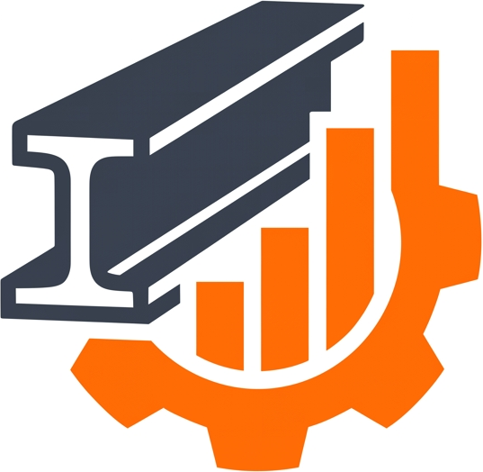
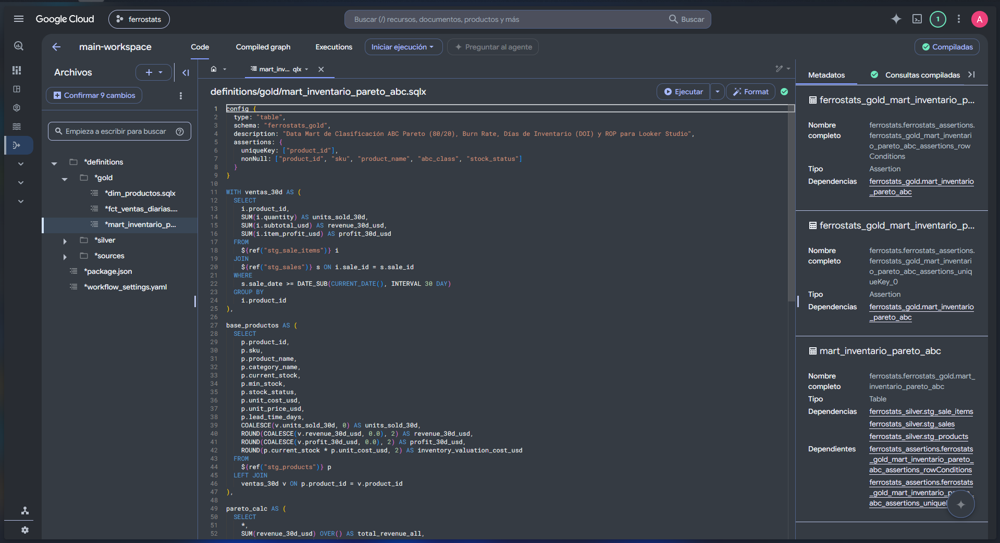
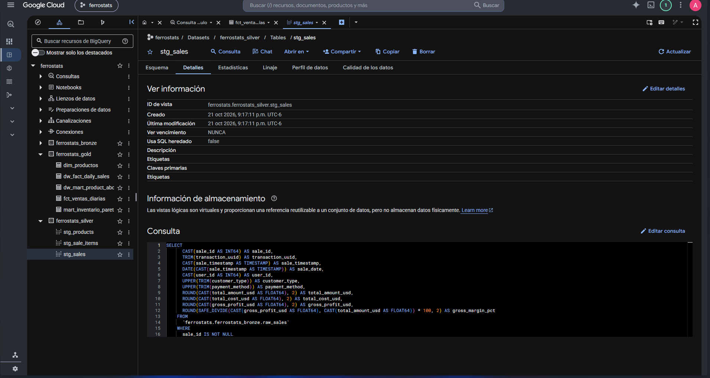
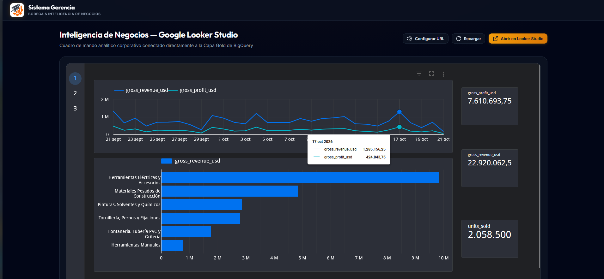
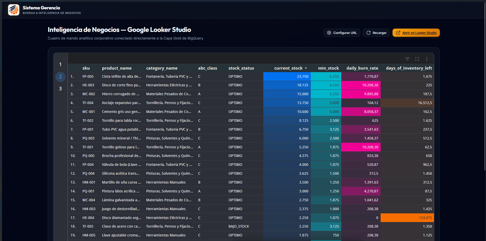
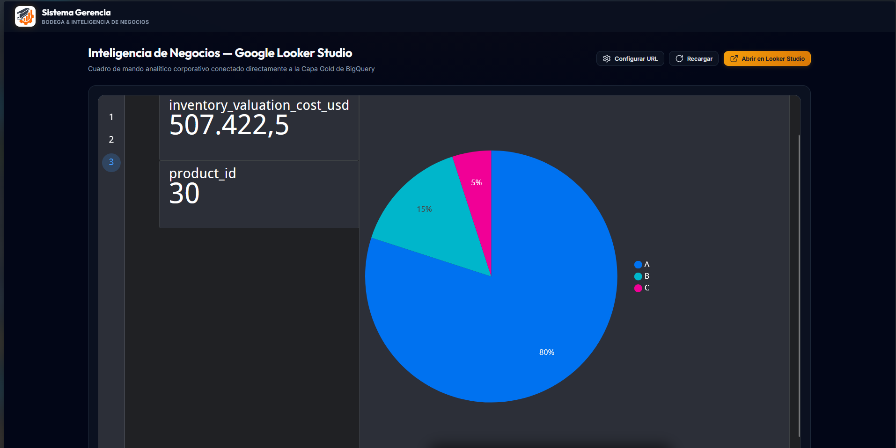
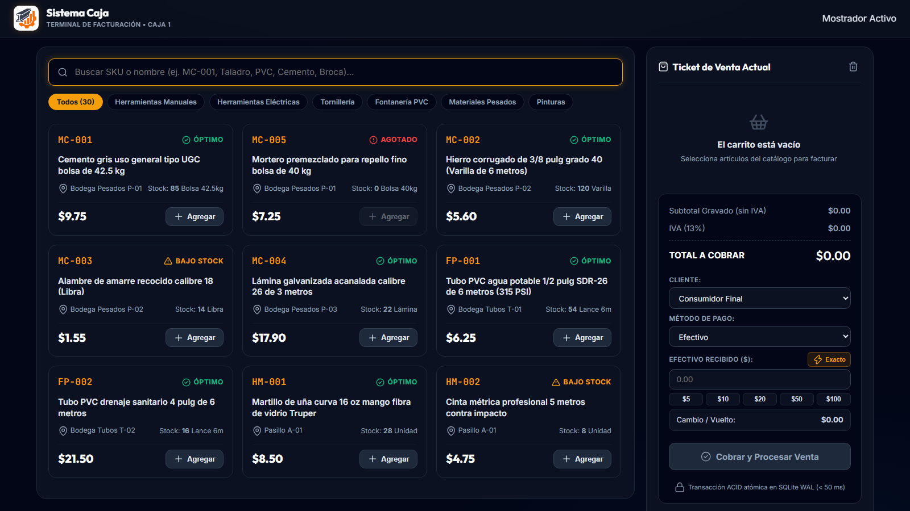
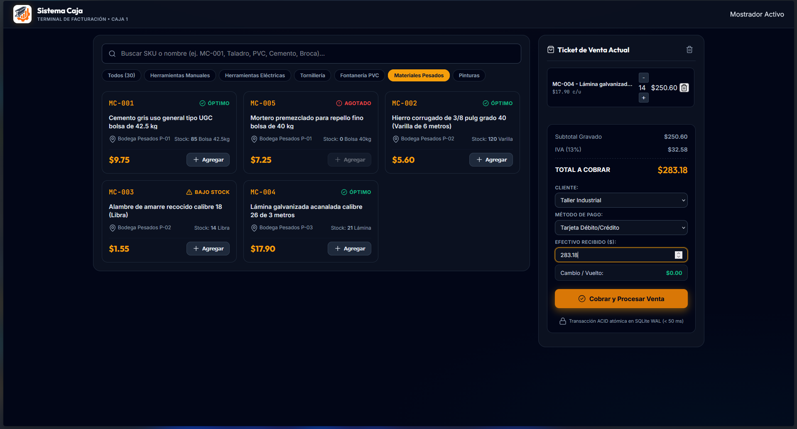

# FERROSTATS — Data Lakehouse Medallón en Google Cloud (BigQuery + Dataform SQLX) y Pipeline de Ingesta Streaming

  

  <strong>Proyecto de Portafolio de Ingeniería de Datos: Data Lakehouse Medallón Automatizado (Bronze / Silver / Gold) en Google BigQuery, Orquestación Declarativa SQLX con Google Dataform, Modelado Analítico con Funciones de Ventana (Pareto 80/20, DOI, ROP) y Gobernanza FinOps de $0.00/mes.</strong>

  
  
  
  
  
  

  <strong>Idioma / Language:</strong> <strong>Español</strong> | <a href="README.md">English Version</a>

> [!IMPORTANT]
> **Enfoque 100 % en Ingeniería de Datos y Rol del Simulador Web:**  
> Este repositorio es un proyecto de **Ingeniería de Datos y Arquitectura Cloud**. Los entregables centrales son el **Data Lakehouse Medallón en Google BigQuery (`ferrostats_bronze` $\to$ `ferrostats_silver` $\to$ `ferrostats_gold`)**, el **pipeline declarativo en Google Dataform SQLX con aserciones de Calidad de Datos**, las **funciones analíticas de ventana en SQL (Pareto 80/20, Burn Rate, DOI, ROP)** y la **arquitectura FinOps de $0.00/mes en GCP**.  
> Dado que un pipeline de ingesta en streaming requiere una fuente transaccional de origen, se generó un simulador web ligero (`/pos` y `/`) mediante **Spec-Driven Development (SDD)** exclusivamente para actuar como **productor sintético de eventos OLTP** hacia BigQuery Bronze.

---

## Recursos de la Plataforma de Datos en Vivo

| Capa de la Plataforma de Datos | Recurso / Enlace en Vivo | Alcance Técnico |
|---|---|---|
| **1. Capa Analítica BI (Looker Studio)** | [**Reporte Ejecutivo Oficial de 3 Páginas en Looker Studio**](https://datastudio.google.com/reporting/2389e684-fc9b-431d-9c56-487b3067eb87/page/p_dwbfqrtk8d) | Conectado nativamente a los Data Marts en Esquema Estrella de BigQuery Gold (`fct_daily_sales`, `mart_inventory_pareto_abc`, `dim_products`). |
| **2. Cloud Data Lakehouse (GCP)** | **Proyecto:** `ferrostats` (`US` / `us-central1`) **Repo Dataform:** `ferrostats-pipeline` (`main-workspace`) | **Bronze:** 7 tablas crudas inmutables **Silver:** 3 vistas curadas SQLX + aserciones DQ **Gold:** 3 tablas analíticas en Esquema Estrella |
| **3. Productor de Eventos OLTP (Cloud Run)** | [**Simulador de Transacciones POS (`/pos`)**](https://ferrostats-bi-platform-s72yk4nsvq-uc.a.run.app/pos) • [**Monitor de Inventario y ROP (`/`)**](https://ferrostats-bi-platform-s72yk4nsvq-uc.a.run.app) | Simulador de ingesta en el borde (`<50 ms` ACID SQLite WAL + idempotencia UUID) que transmite eventos hacia `ferrostats_bronze`. |

---

## Galería Visual del Pipeline y Data Lakehouse

| Etapa del Pipeline | Vista Técnica |
|---|---|
| **1. Google Cloud Dataform (DAG SQLX)** *Grafo Medallón compilado (`raw_*` $\to$ `stg_*` $\to$ Marts Gold y aserciones de calidad)* |  |
| **2. Google BigQuery Data Warehouse** *`ferrostats_bronze` (7 tablas crudas), `ferrostats_silver` (3 vistas) y `ferrostats_gold` (3 Marts Estrella)* |  |
| **3. Looker Studio BI — Página 1 (Tabla de Hechos)** *Alimentado por `ferrostats_gold.fct_daily_sales`: Ingresos, COGS y evolución de margen bruto* |  |
| **4. Looker Studio BI — Página 2 (Pareto y DOI)** *Alimentado por `ferrostats_gold.mart_inventory_pareto_abc`: Matriz ABC 80/20, Burn Rate y DOI* |  |
| **5. Looker Studio BI — Página 3 (Valoración de Capital)** *Alimentado por `dim_products` y `mart_inventory_pareto_abc`: Valoración de inventario por clase ABC* |  |
| **6. Fuente Transaccional A — Productor de Eventos POS (`/pos`)** *Generador de ventas OLTP que transmite eventos hacia `ferrostats_bronze.raw_sales`* |  |
| **7. Fuente Transaccional B — Monitor de Inventario y Tabla ROP (`/`)** *Auditoría de stock y tabla de prioridad de reorden que transmite movimientos hacia `raw_inventory_movements`* |  |

---

## Autor y Contacto

- **Autor:** Diego Alejandro Escobar Barahona — *Data Engineer*
- **Certificación:** [Google Cloud Certified — Associate Data Practitioner](https://www.credly.com/badges/e27fea72-5eaf-47ee-a43c-43faa3a8fb10) (Credential ID: `23e3584a246f4c149f26fea03cebcbbb`)
- **LinkedIn:** [linkedin.com/in/diego-escobar-459256394](https://linkedin.com/in/diego-escobar-459256394)
- **Correo Electrónico:** `diegoalejandroescobarahona1@gmail.com`
- **Licencia:** [Licencia MIT](LICENSE)
