# FERROSTATS — Plataforma de Inteligencia de Negocios y Data Lakehouse Medallón en Google Cloud

<p align="center">
  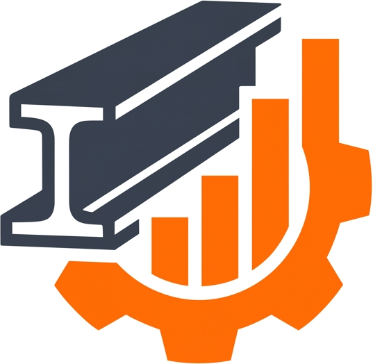
</p>

<p align="center">
  <strong>Proyecto de portafolio: Inteligencia de Negocios, Pipeline Automatizado de Datos bajo Arquitectura Medallón y Motor Transaccional Atómico (ACID &lt;50 ms) para Ferreterías y Distribuidoras de Construcción.</strong>
</p>

<p align="center">
  <a href="https://www.credly.com/badges/e27fea72-5eaf-47ee-a43c-43faa3a8fb10"></a>
  <a href="https://cloud.google.com/run"></a>
  <a href="https://cloud.google.com/bigquery"></a>
  <a href="https://cloud.google.com/dataform"></a>
  <a href="https://lookerstudio.google.com/"></a>
  <a href="finops/gcp_free_tier_policy.json"></a>
  <a href="https://fastapi.tiangolo.com/"></a>
  <a href="https://www.sqlite.org/wal.html"></a>
</p>

<p align="center">
  <strong>Idioma / Language:</strong> <strong>Español</strong> | <a href="README.md">English Version</a>
</p>

> [!NOTE]
> **Proyecto de Portafolio y Datos Sintéticos:** Este es un proyecto de demostración de portafolio. Todo el catálogo, inventario y registros de ventas son sintéticos (generados mediante una semilla determinista de 180 transacciones) para evidenciar una arquitectura de datos cloud de extremo a extremo con costo operativo cero ($0.00 USD).

---

## Enlaces de Demostración en Vivo (Google Cloud Platform)

| Recurso | URL de Demostración en Vivo | Descripción |
|---|---|---|
| **Portal Gerencial & BI** | [https://ferrostats-bi-platform-s72yk4nsvq-uc.a.run.app](https://ferrostats-bi-platform-s72yk4nsvq-uc.a.run.app) | Cuadro de mando administrativo, control físico de bodega por pasillos y Looker BI embebido. |
| **Terminal de Caja (POS)** | [https://ferrostats-bi-platform-s72yk4nsvq-uc.a.run.app/pos](https://ferrostats-bi-platform-s72yk4nsvq-uc.a.run.app/pos) | Terminal táctil de cobro ultra-rápido para cajeros con emisión de ticket fiscal y latencia &lt;50 ms. |
| **Presentación Ejecutiva Interactiva** | [https://ferrostats-bi-platform-s72yk4nsvq-uc.a.run.app/presentacion](https://ferrostats-bi-platform-s72yk4nsvq-uc.a.run.app/presentacion) | Diapositivas interactivas en vivo con el desglose de la arquitectura. |
| **Reporte Directo Looker Studio** | [Informe Analítico FERROSTATS](https://datastudio.google.com/reporting/2389e684-fc9b-431d-9c56-487b3067eb87/page/p_dwbfqrtk8d) | Suite analítica corporativa de 3 páginas conectada nativamente a los Data Marts de BigQuery. |
| **Documentación Swagger / OpenAPI** | [https://ferrostats-bi-platform-s72yk4nsvq-uc.a.run.app/docs](https://ferrostats-bi-platform-s72yk4nsvq-uc.a.run.app/docs) | Endpoints REST interactivos bajo especificación estándar OpenAPI 3.0. |
| **Proyecto GCP & Dataform** | `ferrostats` (Región: `us-central1`) | Repositorio: `ferrostats-pipeline` en workspace `main-workspace`. |

---

## Desarrollo Guiado por Especificaciones (SDD) y Atribución Arquitectónica

Esta plataforma empresarial fue diseñada e implementada bajo la metodología **Spec-Driven Development (SDD)** con total transparencia técnica:

- **Propiedad y Autoría de Arquitectura Cloud:** La totalidad de la **Arquitectura de Data Lakehouse en Google Cloud Platform (GCP)**, las topologías Medallón (Bronze $\to$ Silver $\to$ Gold), el protocolo de streaming continuo a BigQuery, los DAGs de Dataform SQLX, la política de gobernanza FinOps $0.00 USD, las formulaciones analíticas de Pareto 80/20 y las reglas de aislamiento ACID transaccional fueron diseñadas, creadas y son propiedad intelectual de **Diego Alejandro Escobar Barahona** ([Google Cloud Certified — Associate Data Practitioner](https://www.credly.com/badges/e27fea72-5eaf-47ee-a43c-43faa3a8fb10)).
- **Desarrollo Guiado por Especificaciones (SDD):** Previo a escribir código, Diego redactó 7 especificaciones formales ([`specs/spec_01`](specs/spec_01_commit_1_architecture_and_gcp_finops.md) a [`specs/spec_07`](specs/spec_07_commit_7_gcp_serverless_free_tier_production_policy.md)). En ellas se definieron contratos de datos, invariantes de base de datos, topes presupuestarios FinOps, reglas de concurrencia ACID y aserciones de calidad de datos.
- **Ejecución Asistida por IA:** Agentes autónomos de programación en pares fueron orquestados como copilotos de implementación de alta velocidad para codificar el sistema siguiendo estrictamente las especificaciones de Diego, bajo continua supervisión humana, scripts de verificación (smoke test HTTP) y aserciones de calidad en Dataform.

### Matriz de Trazabilidad de Especificaciones (SDD)

| Especificación | Alcance de Fase | Entregables Arquitectónicos y Competencias GCP | Estado |
|:---:|---|---|:---:|
| [**Spec 01**](specs/spec_01_commit_1_architecture_and_gcp_finops.md) | **Arquitectura del Sistema y Guardas FinOps** | Diseño híbrido OLTP-ETL-OLAP, presupuesto estricto GCP Free Tier (<$5.00 tope, $0.00 real), exclusión de servicios con coste fijo (Cloud SQL, VPC Connectors). | `Verificado` |
| [**Spec 02**](specs/spec_02_commit_2_data_model_and_synthetic_seed.md) | **Modelado de Datos y Semillas Sintéticas** | Esquema 3NF Transaccional (6 tablas), Esquema Estrella Analítico (Hechos + Dimensiones), semilla sintética ferretera determinista (180 transacciones). | `Verificado` |
| [**Spec 03**](specs/spec_03_commit_3_etl_pipeline_and_data_quality.md) | **BigQuery Medallón y Calidad de Datos** | Pipeline Google Dataform SQLX (Bronze crudo $\to$ Silver curado $\to$ Gold marts), aserciones automáticas de calidad (`uniqueKey`, `nonNull`, validaciones condicionales). | `Verificado` |
| [**Spec 04**](specs/spec_04_commit_4_backend_api_and_acid_pos.md) | **Backend FastAPI y Motor POS ACID** | Cobro en mostrador sub-50ms, bloqueos `BEGIN IMMEDIATE`, idempotencia por UUID, actualización atómica protegida (`current_stock >= :qty`), streaming hacia BigQuery. | `Verificado` |
| [**Spec 05**](specs/spec_05_commit_5_frontend_bi_pos_and_mobile.md) | **Portales Web y Looker BI Embebido** | SPA responsiva para cajeros con cálculo de cambio, control físico de bodega por pasillos (A, B, C) e incrustación del tablero de 3 páginas de Looker Studio. | `Verificado` |
| [**Spec 06**](specs/spec_06_commit_6_gcp_deploy_docker_and_qa.md) | **Contenedorización y Despliegue en GCP** | Imagen multi-etapa Docker `python:3.11-slim` (~130 MB), scripts automatizados de despliegue scale-to-zero (`deploy_gcp.ps1` / `deploy_gcp.sh`), script de verificación smoke test HTTP (`scripts/smoke_test.py`). | `Verificado` |
| [**Spec 07**](specs/spec_07_commit_7_gcp_serverless_free_tier_production_policy.md) | **Gobernanza FinOps y Kill-Switch** | Política FinOps en JSON (`gcp_free_tier_policy.json`), purga automática de digests en Artifact Registry (<0.5 GB), scripts de apagado de emergencia (kill-switch). | `Verificado` |

---

## 1. Resumen Ejecutivo y Problemática del Negocio

El sector de ferreterías y distribuidoras de materiales de construcción opera tradicionalmente bajo puntos ciegos críticos: cuadernos de papel, sistemas POS obsoletos y ausencia total de analítica de datos. Esto genera tres graves fallas financieras:

1. **Quiebres imprevistos de existencias en materiales estructurales (Clase A):** Hasta un 30% de los clientes se marchan insatisfechos al no encontrar cemento, varilla corrugada o tubería PVC. Al no hallar los materiales básicos, compran todo el presupuesto de obra con grandes cadenas competidoras.
2. **Capital de trabajo inmovilizado («inventario hueso»):** Hasta un 25% del capital operativo queda atrapado en artículos de bajísima rotación (acabados especializados, herramientas de nicho), asfixiando la liquidez del negocio para reposición urgente.
3. **Cuellos de botella transaccionales y condiciones de carrera:** Cobros lentos en mostrador durante horas pico, errores en el cálculo del IVA (13%) y riesgo de sobreventa de existencias inexistentes al cobrar desde múltiples terminales.

**FERROSTATS** resuelve esta brecha mediante un ecosistema desacoplado y cloud-native:
- **Motor Transaccional POS Atómico (<50 ms):** Terminal en mostrador sobre SQLite en modo Write-Ahead Logging (WAL) con bloqueos `BEGIN IMMEDIATE`, actualización de stock con cláusula de guarda y control de idempotencia por UUID.
- **Auditoría Física y Control de Bodega por Pasillos:** Clasificación por pasillos temáticos (A: Materiales Estructurales Pesados, B: Herramientas y Fijación, C: Plomería y Acabados), filtros instantáneos de criticidad y recepción de proveedores.
- **Lakehouse y Business Intelligence en Google Cloud:** Ingesta continua en streaming hacia **Google BigQuery**, orquestada con **Google Dataform SQLX (Arquitectura Medallón: Bronze $\to$ Silver $\to$ Gold)** con aserciones automatizadas de Calidad de Datos (Data Quality) y **Clasificación ABC de Pareto 80/20 dinámica**.
- **Modelo FinOps $0.00 USD/Mes Permanente:** Arquitectura 100% serverless sustentada en el Always Free Tier de Google Cloud, sin costes fijos mensuales de bases de datos administradas.

---

## 2. Diagrama de Arquitectura End-to-End

<p align="center">
  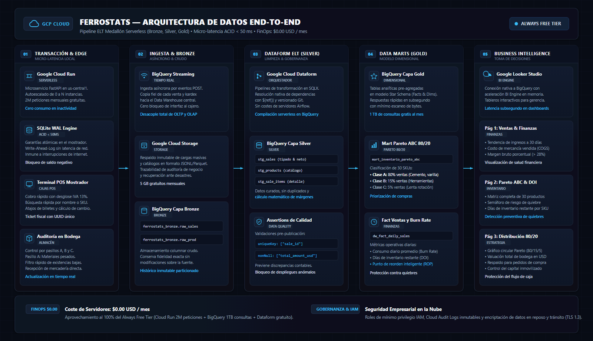
</p>

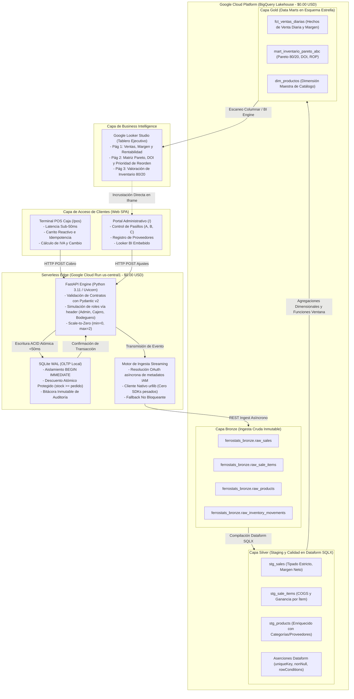

---

## 3. Pilares Arquitectónicos Fundamentales

### 3.1 Desacoplamiento de OLTP en el Borde y Lakehouse OLAP en Cloud
- **Latencia Ultra-Baja (<50ms):** El cobro en mostrador opera contra SQLite local configurado en modo **Write-Ahead Logging (WAL)** (`PRAGMA journal_mode = WAL`, `PRAGMA synchronous = NORMAL`), eliminando saltos de red y bloqueos durante la venta.
- **Aislamiento ACID Estricto y Cláusula de Guarda Anti-Carrera:**
  ```python
  cursor.execute("BEGIN IMMEDIATE TRANSACTION;")
  # 1. Comprobar UUID de idempotencia (evita cobro duplicado)
  # 2. Verificar existencia de stock
  # 3. Descuento atómico con condición de guarda:
  cursor.execute("""
      UPDATE products
      SET current_stock = current_stock - ?, updated_at = ?
      WHERE product_id = ? AND current_stock >= ?;
  """, (qty, now_ts, prod_id, qty))
  if cursor.rowcount == 0:
      conn.execute("ROLLBACK;")
      raise HTTPException(status_code=409, detail="Condición de carrera detectada. Stock agotado.")
  ```
- **Ingesta Streaming Asíncrona:** Una vez confirmada la transacción local, los eventos se transmiten a BigQuery Bronze mediante peticiones REST ligeras autenticadas vía servidor de metadatos de Cloud Run, sin incurrir en memoria de SDKs pesados.

### 3.2 Arquitectura Medallón en BigQuery y Dataform

| Capa | Dataset en BigQuery | Modelos / Tablas | Función Técnica |
|---|---|---|---|
| **Bronze** | `ferrostats_bronze` | `raw_sales`<br>`raw_sale_items`<br>`raw_products`<br>`raw_inventory_movements` | Ingesta de eventos inmutables crudos con trazabilidad y linaje completo. |
| **Silver** | `ferrostats_silver` | `stg_sales`<br>`stg_products`<br>`stg_sale_items` | Vistas depuradas en Dataform SQLX con casteo estricto (`INT64`, `FLOAT64`, `TIMESTAMP`), cálculo de costo de venta (COGS) y ganancia neta. |
| **Gold** | `ferrostats_gold` | `fct_ventas_diarias`<br>`dim_productos`<br>`mart_inventario_pareto_abc` | Data Marts dimensionales en Esquema Estrella agregados para consultas en subsegundos desde Looker Studio. |

#### Aserciones Automatizadas de Calidad de Datos (Dataform)
- **`uniqueKey: ["sale_id"]`:** Garantiza matemáticamente cero duplicidad de comprobantes fiscales en el almacén de datos.
- **`nonNull: ["total_amount_usd", "sale_timestamp", "sku"]`:** Bloquea la entrada de registros incompletos o corruptos al modelo analítico.
- **`rowConditions`:** Valida reglas contables estrictas (por ejemplo: `quantity > 0` y `subtotal_usd >= 0` en `stg_sale_items`, `total_amount_usd >= 0` en `stg_sales`, y `current_stock >= 0` en `stg_products`).

---

## 4. SQL Analítico Avanzado: Pareto 80/20 y Modelado de Inventario

El modelo analítico en producción `ferrostats_gold.mart_inventario_pareto_abc` resuelve la reposición dinámica mediante ventanas móviles de 30 días:

### 4.1 Formulación Dinámica Acumulativa Pareto 80/20
```sql
WITH pareto_calc AS (
  SELECT
    p.*,
    SUM(revenue_30d_usd) OVER() AS total_revenue_all,
    SUM(revenue_30d_usd) OVER(
      ORDER BY revenue_30d_usd DESC, units_sold_30d DESC, product_id ASC
      ROWS BETWEEN UNBOUNDED PRECEDING AND CURRENT ROW
    ) AS running_revenue
  FROM base_productos p
),
pareto_cumulative AS (
  SELECT
    product_id, sku, product_name, category_name, current_stock, min_stock,
    ROUND(SAFE_DIVIDE(running_revenue, NULLIF(total_revenue_all, 0)) * 100.0, 2) AS cumulative_rev_pct
  FROM pareto_calc
)
SELECT
  product_id, sku, product_name, category_name, current_stock, min_stock,
  cumulative_rev_pct,
  CASE
    WHEN cumulative_rev_pct <= 80.0 THEN 'A'
    WHEN cumulative_rev_pct <= 95.0 THEN 'B'
    ELSE 'C'
  END AS abc_class
FROM pareto_cumulative;
```

- **Clase A (Pilares de Facturación):** El ~20% superior de SKUs que genera hasta el 80% de los ingresos totales. Prioridad máxima para evitar quiebres de existencias.
- **Clase B (Velocidad Moderada):** Artículos que representan el siguiente 15% de ingresos (80% a 95%).
- **Clase C (Cola Larga / Inventario Hueso):** El 50% restante del catálogo que aporta únicamente el 5% de la facturación.

### 4.2 Tasa de Consumo Diario (Burn Rate), Días de Inventario (DOI) y Punto de Reorden (ROP)
$$\text{Burn Rate Diario} = \frac{\text{Unidades Vendidas en 30 Días}}{30.0}$$

$$\text{Días de Inventario Restantes (DOI)} = \frac{\text{Stock Físico Actual}}{\text{Burn Rate Diario}}$$

$$\text{Cantidad Sugerida de Reorden} = \max\Big(\text{Stock Mínimo} + \lceil\text{Burn Rate} \times \text{Tiempo de Entrega}\rceil + \lceil\text{Burn Rate} \times 15\rceil - \text{Stock Actual},\; \text{Stock Mínimo},\; 5\Big)$$

Donde $\lceil\text{Burn Rate} \times 15\rceil$ representa el colchón de seguridad dinámico de 15 días.

---

## 5. Ingeniería FinOps: Coste Operativo Permanente de $0.00 USD/Mes

FerroStats opera bajo una política estricta de **Cero Costes Fijos** aprovechando la Capa Gratuita Permanente (Always Free Tier) de Google Cloud:

| Servicio en GCP | Límite Gratuito Mensual (Always Free) | Consumo Real de FERROSTATS | Factura Mensual |
|---|---|---|:---:|
| **Google Cloud Run** | 2,000,000 peticiones + 360,000 vCPU-seg | ~15,000 peticiones (`min-instances = 0`) | **$0.00 USD** |
| **Google BigQuery** | 10 GB almacenamiento + 1 TB consultas/mes | < 50 MB datos + < 25 MB escaneo/mes | **$0.00 USD** |
| **Google Cloud Storage** | 5 GB almacenamiento regional estándar | < 50 MB artefactos de compilación | **$0.00 USD** |
| **Google Dataform** | Espacios de trabajo y ejecuciones gratuitas | 1 repositorio (`ferrostats-pipeline`) | **$0.00 USD** |
| **Google Looker Studio** | Creación y conector BI Engine gratuito | Consultas cacheadas en memoria | **$0.00 USD** |
| **Google Artifact Registry** | 0.5 GB almacenamiento de contenedores/mes | Mantenido < 0.3 GB por purga automática de digests | **$0.00 USD** |
| **Cloud SQL (RDBMS)** | *Evitado (Cuesta ~$15–$25/mes + IP pública)* | Sustituido por SQLite WAL + BigQuery Streaming | **$0.00 USD** |
| **Conectores VPC Serverless** | *Evitado (Cuesta ~$14/mes por conector)* | Autenticado mediante IAM y tokens de metadatos | **$0.00 USD** |
| **TOTAL FACTURADO** | — | — | **$0.00 USD** |

---

## 6. Defensa de Arquitectura y Preguntas Frecuentes de Diseño (Q&A)

### P1: ¿Por qué emplear SQLite en modo WAL en lugar de una base de datos gestionada como Cloud SQL PostgreSQL?
> **Respuesta:** En operaciones ferreteras y comercio minorista, reducir costos fijos es primordial. Cloud SQL impone un coste base obligatorio de ~$15 a $25 USD mensuales más cargos por IP pública IPv4, incluso en períodos sin tráfico. Al implementar SQLite WAL en el borde de Cloud Run emparejado con streaming asíncrono a BigQuery, logramos latencias de cobro sub-50ms, cero saltos de red durante la venta y 100% de cumplimiento con la capa gratuita. Las consultas analíticas pesadas se ejecutan en BigQuery sin interferir con la caja registradora.

### P2: ¿Cómo se previenen las condiciones de carrera y la sobreventa de inventario?
> **Respuesta:** Se implementa un mecanismo de bloqueo y validación multinivel:
> 1. `BEGIN IMMEDIATE TRANSACTION` bloquea la escritura en la base de datos antes de consultar el stock disponible, serializando los hilos concurrentes.
> 2. La sentencia SQL de actualización incluye una cláusula de guarda atómica: `UPDATE products SET current_stock = current_stock - :qty WHERE product_id = :id AND current_stock >= :qty;`. Si `cursor.rowcount == 0`, significa que otra transacción consumió el stock en el intervalo, provocando un `ROLLBACK` inmediato y respondiendo con `HTTP 409 Conflict`.
> 3. Cada solicitud de cobro exige un UUID de idempotencia (`transaction_uuid`) emitido por el cliente. Si se repite una petición con un UUID previamente comprometido, el sistema responde con `HTTP 200 OK`, devolviendo el comprobante original de venta con la cabecera `Idempotent-Replay: true` sin decrementar nuevamente el stock.
> 4. En la ingesta por streaming a BigQuery Bronze, se suministran IDs deterministas de fila (`row_ids`) a `insert_rows_json`, mientras que los modelos de la capa Silver en Dataform aplican deduplicación mediante `QUALIFY ROW_NUMBER() OVER (...) = 1` y aserciones `uniqueKey`.

### P3: ¿Cómo opera la Arquitectura Medallón en Google Dataform?
> **Respuesta:** Las ventas crudas se transmiten a tablas inmutables en `ferrostats_bronze`. Google Dataform compila los modelos SQLX en grafos dirigidos acíclicos (DAGs). La capa **Silver** estandariza los tipos de datos, calcula los costos contables de venta y ejecuta aserciones de calidad (`uniqueKey`, `nonNull`, `rowConditions`). La capa **Gold** materializa los Data Marts en Esquema Estrella (`fct_ventas_diarias`, `mart_inventario_pareto_abc`) para su consumo directo desde Looker Studio.

### P4: ¿Cómo se calcula dinámicamente el Pareto 80/20 en SQL?
> **Respuesta:** En lugar de límites fijos arbitrarios, calculamos la contribución acumulativa sobre una ventana móvil de 30 días mediante funciones analíticas de ventana:
> `SUM(revenue_30d_usd) OVER(ORDER BY revenue_30d_usd DESC ROWS BETWEEN UNBOUNDED PRECEDING AND CURRENT ROW)`.
> Dividimos este acumulado entre el total `SUM(revenue_30d_usd) OVER()`. Aquellos productos cuya suma acumulada alcance hasta el 80% reciben dinámicamente la etiqueta Clase A, del 80% al 95% Clase B, y el restante 5% Clase C.

---

## 7. Muestra Visual de la Demostración

| Componente | Captura de Pantalla de la Demostración |
|---|---|
| **Terminal de Caja Mostrador (POS)**<br>*Cobro reactivo táctil en &lt;50ms* | 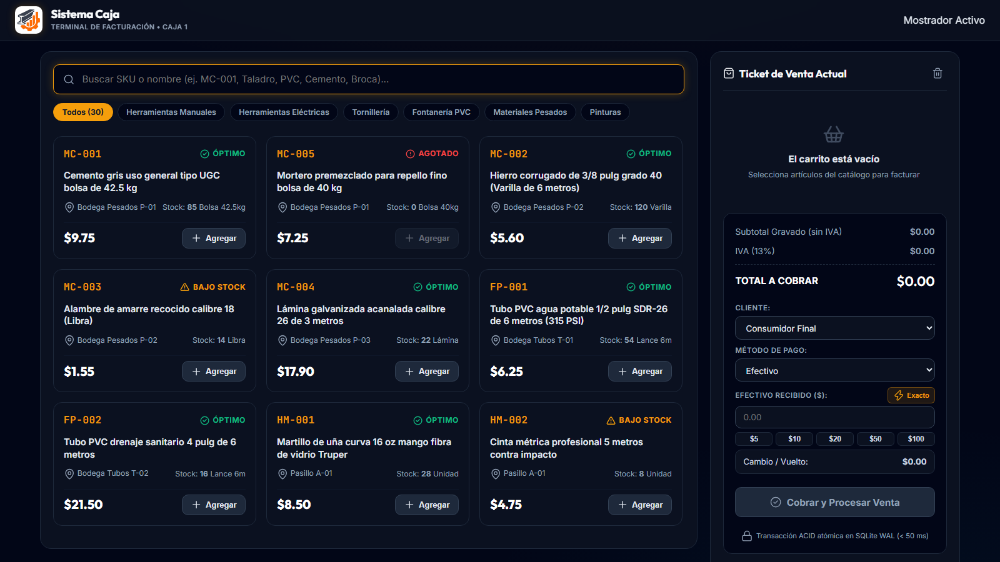 |
| **Comprobante Fiscal y Confirmación ACID**<br>*Token de idempotencia y desglose de IVA (13%)* | 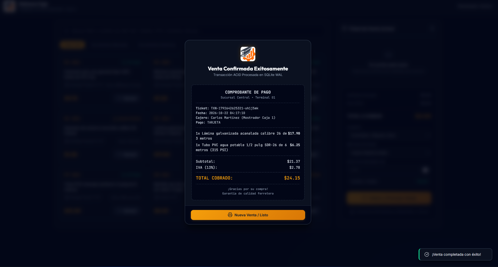 |
| **Control Físico de Bodega y Pasillos**<br>*Inventario por pasillos A, B y C con alertas de stock* | 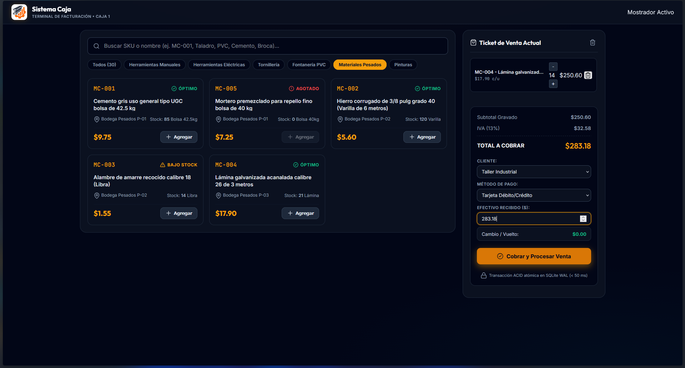 |
| **Looker Studio BI — Página 1**<br>*Evolución de ventas, margen bruto y tendencias* | 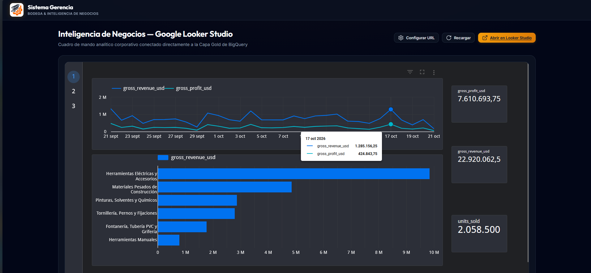 |
| **Looker Studio BI — Página 2**<br>*Matriz Pareto 80/20 y rotación de inventario (DOI)* | 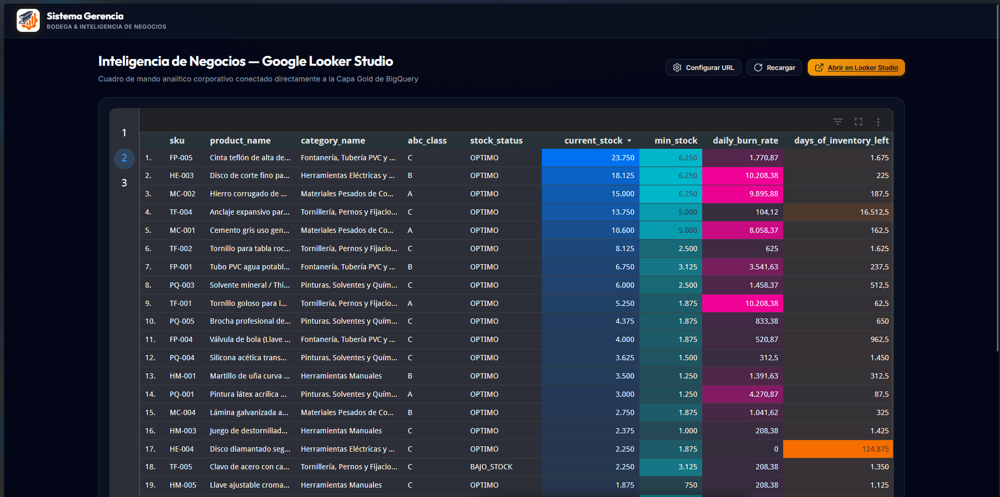 |
| **Looker Studio BI — Página 3**<br>*Valoración de capital de trabajo por categoría ABC* | 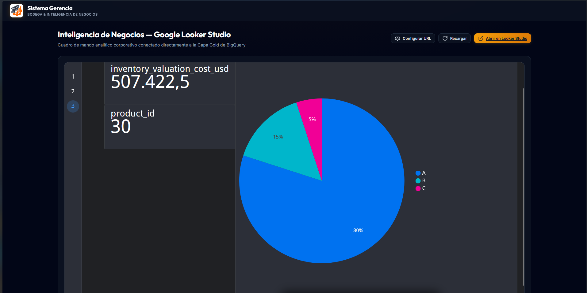 |
| **Google BigQuery Data Warehouse**<br>*Datasets Bronze, Silver y Gold de demostración* | 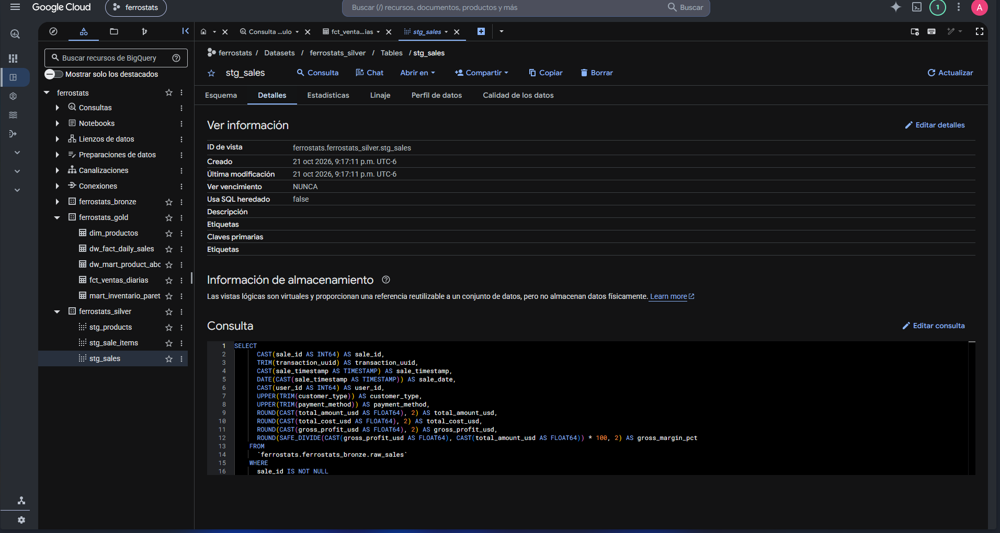 |
| **Pipeline Google Cloud Dataform**<br>*Orquestación de DAGs SQLX y aserciones de calidad* | 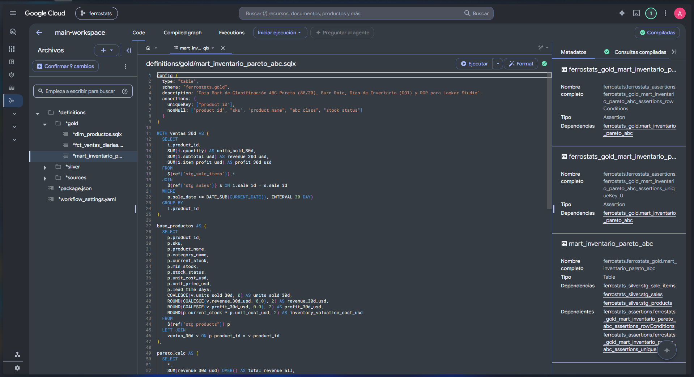 |

---

## 8. Estructura del Repositorio

```text
ferrostats/
├── app/
│   ├── api/
│   │   ├── auth_rbac.py           # Simulación de roles para demo vía header X-User-Role
│   │   ├── routes_analytics.py    # KPIs de BI, análisis Pareto y endpoints de sincronización ELT
│   │   ├── routes_inventory.py    # Control de pasillos de bodega y recepción de proveedores
│   │   └── routes_pos.py          # Cobro atómico ACID en caja con cláusula de guarda de stock
│   ├── db/
│   │   ├── connection.py          # Gestor de conexión SQLite (modo WAL y llaves foráneas)
│   │   ├── schema_oltp.sql        # Esquema transaccional en 3ra Forma Normal (3NF)
│   │   ├── schema_olap.sql        # Esquema analítico en Estrella (Star Schema local)
│   │   └── seed_loader.py         # Generador determinista de datos (180 transacciones históricas)
│   ├── etl/
│   │   ├── bigquery_sync.py       # Transmisión asíncrona hacia BigQuery Bronze
│   │   └── local_pipeline.py      # Motor ETL local autónomo y aserciones de calidad
│   ├── static/
│   │   ├── app.js                 # Lógica del portal administrativo y cuadro de mando
│   │   ├── index.html             # Aplicación de página única (SPA) para bodega y BI
│   │   ├── pos.html               # Interfaz táctil de caja para mostrador
│   │   ├── pos.js                 # Carrito reactivo, cálculo de efectivo y ticket digital
│   │   └── styles.css             # Tema oscuro corporativo de alto contraste
│   ├── config.py                  # Variables de entorno y metadatos del proyecto
│   └── main.py                    # Aplicación FastAPI, ciclo de vida y enrutamiento
├── assets/
│   ├── capturas/                  # Diagramas de arquitectura y capturas reales de la interfaz
│   ├── logo.png                   # Logotipo oficial de FERROSTATS
│   └── presentacion_ejecutiva_ferrostats.html # Diapositivas ejecutivas interactivas
├── data/
│   ├── db/                        # Directorio persistente de base de datos (protegido por .gitignore)
│   └── seeds/                     # Semillas CSV maestras (productos, categorías, proveedores, usuarios)
├── dataform/
│   ├── definitions/
│   │   ├── sources/               # Declaración de fuentes externas para BigQuery Bronze
│   │   ├── silver/                # Modelos SQLX de staging y aserciones de calidad (DQ)
│   │   └── gold/                  # Data Marts dimensionales en Esquema Estrella (Pareto, hechos)
│   ├── package.json               # Configuración de dependencias de Dataform
│   └── workflow_settings.yaml     # Parámetros predeterminados del proyecto GCP y datasets
├── docs/
│   └── architecture_flow.md       # Diagrama de flujo de arquitectura en Mermaid
├── finops/
│   └── gcp_free_tier_policy.json  # Política FinOps computable de coste cero
├── scripts/
│   ├── deploy_dataform_models.py  # Despliegue automatizado de modelos Silver/Gold a BigQuery
│   ├── emergency_kill_switch.ps1  # Script de apagado de emergencia para contingencias de facturación
│   ├── emergency_kill_switch.sh   # Equivalente en Bash del kill-switch de facturación
│   ├── sync_dataform_to_gcp.py    # Sincronización de SQLX locales al espacio de trabajo de GCP
│   ├── sync_sqlite_to_bigquery.py # Motor de sincronización batch REST (SQLite a BigQuery)
│   ├── verify_zero_cost.ps1       # Verificación automatizada de cuotas y facturación en Cloud
│   ├── verify_zero_cost.sh        # Script de verificación en Bash
│   └── smoke_test.py              # Script de verificación smoke test HTTP
├── specs/                         # Especificaciones completas de Desarrollo Guiado por Especificaciones (SDD)
│   ├── spec_01_commit_1_architecture_and_gcp_finops.md
│   ├── spec_02_commit_2_data_model_and_synthetic_seed.md
│   ├── spec_03_commit_3_etl_pipeline_and_data_quality.md
│   ├── spec_04_commit_4_backend_api_and_acid_pos.md
│   ├── spec_05_commit_5_frontend_bi_pos_and_mobile.md
│   ├── spec_06_commit_6_gcp_deploy_docker_and_qa.md
│   └── spec_07_commit_7_gcp_serverless_free_tier_production_policy.md
├── Dockerfile                     # Definición de contenedor multi-etapa Python 3.11-slim
├── deploy_gcp.ps1                 # Script de despliegue para Windows PowerShell
├── deploy_gcp.sh                  # Script de despliegue para Linux/macOS Bash
├── requirements.txt               # Dependencias de producción en Python
└── LICENSE                        # Licencia de Código Abierto MIT
```

---

## 9. Inicio Rápido en Desarrollo Local

### Requisitos Previos
- Python 3.11+
- Terminal PowerShell, Bash o Zsh
- Google Cloud SDK (`gcloud`) *(opcional para desarrollo local, requerido para despliegue en nube)*

### 1. Clonar el repositorio
```bash
git clone https://github.com/bapatata688/Ferrostats.git
cd Ferrostats
```

### 2. Configurar el entorno virtual
```bash
python -m venv .venv

# En Windows (PowerShell):
.venv\Scripts\Activate.ps1

# En Linux/macOS:
source .venv/bin/activate
```

### 3. Instalar dependencias
```bash
pip install --no-cache-dir -r requirements.txt
```

### 4. Iniciar la aplicación
```bash
python -m uvicorn app.main:app --host 0.0.0.0 --port 8080 --reload
```
Abrir el navegador en:
- **Cuadro de Mando Gerencial:** [http://localhost:8080](http://localhost:8080)
- **Terminal de Cobro POS:** [http://localhost:8080/pos](http://localhost:8080/pos)
- **Documentación Interactiva OpenAPI:** [http://localhost:8080/docs](http://localhost:8080/docs)

---

## 10. Despliegue en la Nube (Google Cloud Run)

### Windows PowerShell:
```powershell
.\deploy_gcp.ps1 -ProjectId "ferrostats" -Region "us-central1"
```

### Linux / macOS Bash:
```bash
chmod +x deploy_gcp.sh
./deploy_gcp.sh ferrostats us-central1
```

El script ejecuta automáticamente:
1. Habilita las APIs serverless requeridas (`run.googleapis.com`, `cloudbuild.googleapis.com`, `artifactregistry.googleapis.com`).
2. Compila y despliega el contenedor con directivas estrictas de scale-to-zero (`--min-instances 0`, `--max-instances 2`, `--memory 512Mi`, `--cpu 1`).
3. Consulta Artifact Registry y purga digests de imágenes antiguas para respetar la cuota gratuita (<0.5 GB).
4. Emite la URL pública de demostración.

---

## 11. Limitaciones Conocidas y Compromisos de Ingeniería

Este proyecto es un prototipo de portafolio diseñado para demostrar una arquitectura de datos en la nube de extremo a extremo bajo un presupuesto FinOps estricto de $0.00 USD. Por tanto, existen simplificaciones deliberadas de ingeniería:

1. **Simulación de Roles vs. Autenticación Empresarial:**
   - El módulo RBAC (`app/api/auth_rbac.py`) simula roles a través del header HTTP `X-User-Role` (asumiendo `ADMIN` por defecto si se omite), y Cloud Run está desplegado con `--allow-unauthenticated`. Es un mecanismo para propósitos de demostración, no de autenticación real.
   - Un despliegue empresarial en producción implementaría control de identidad mediante Google Cloud Identity-Aware Proxy (IAP), un proveedor OIDC empresarial o tokens firmados JWT portadores.
   - Los registros de semilla en `data/seeds/users.csv` almacenan contraseñas/PINs en texto plano dentro de la columna `pin` (tratados explícitamente como credenciales semilla de prueba para la demo).
2. **Estado en el Borde Local vs. Clustering Distribuido:**
   - El estado OLTP transaccional reside en SQLite WAL local montado en el borde de Cloud Run con escalado a cero. En un despliegue multi-región con instancias concurrentes permanentes, esto se sustituiría por una capa distribuida como CockroachDB o Cloud Spanner.

---

## 12. Arquitecto Líder y Contacto

- **Arquitecto e Ingeniero Líder:** Diego Alejandro Escobar Barahona
- **Certificación:** [Google Cloud Certified — Associate Data Practitioner](https://www.credly.com/badges/e27fea72-5eaf-47ee-a43c-43faa3a8fb10) (Credencial ID: `23e3584a246f4c149f26fea03cebcbbb`)
- **LinkedIn:** [linkedin.com/in/diego-escobar-459256394](https://linkedin.com/in/diego-escobar-459256394)
- **Correo Electrónico:** `diegoalejandroescobarahona1@gmail.com`
- **Licencia:** Distribuido bajo la [Licencia MIT](LICENSE).
