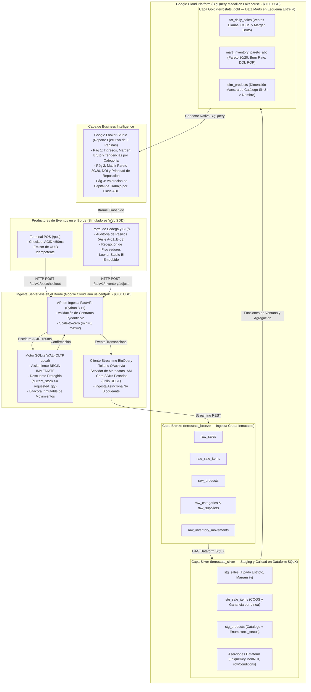

# FERROSTATS — Pipeline de Ingesta OLTP-a-OLAP y Data Lakehouse Medallón en Google Cloud

  

  <strong>Proyecto de Portafolio de Ingeniería de Datos: Ingesta Streaming Serverless OLTP-a-OLAP, Data Lakehouse Medallón Automatizado (Google BigQuery + Dataform SQLX), Analítica Dinámica de Inventario Pareto 80/20 y Gobernanza FinOps de $0.00/mes.</strong>

  
  
  
  
  
  
  
  

  <strong>Idioma / Language:</strong> <strong>Español</strong> | <a href="README.md">English Version</a>

> [!NOTE]
> **Alcance de Ingeniería de Datos y Carga Sintética:** Este repositorio demuestra una **Arquitectura de Ingeniería de Datos y Cloud Data Lakehouse** de extremo a extremo operando con un costo permanente de **$0.00 USD/mes** en Google Cloud Platform. Todos los SKUs, movimientos de inventario y transacciones POS son generados sintéticamente (semilla determinista de 180 ventas sobre 30 SKUs ferreteros estandarizados en inglés). Las interfaces web (`/` y `/pos`) funcionan como **productores de eventos transaccionales en el borde** construidos bajo **Spec-Driven Development (SDD)** para alimentar en tiempo real el pipeline Medallón en BigQuery.

---

## Enlaces de Demostración en Vivo (Google Cloud Platform)

| Componente | URL / Recurso en Vivo | Rol Arquitectónico |
|---|---|---|
| **Reporte Ejecutivo Looker Studio BI** | [Informe Analítico FERROSTATS](https://datastudio.google.com/reporting/2389e684-fc9b-431d-9c56-487b3067eb87/page/p_dwbfqrtk8d) | Suite BI de 3 páginas conectada nativamente a los Data Marts Gold de BigQuery (`fct_daily_sales`, `mart_inventory_pareto_abc`, `dim_products`). |
| **Portal de Auditoría de Bodega & BI** | [https://ferrostats-bi-platform-s72yk4nsvq-uc.a.run.app](https://ferrostats-bi-platform-s72yk4nsvq-uc.a.run.app) | Productor de eventos de ajuste de inventario por pasillos y portal con Looker BI embebido. |
| **Simulador POS Productor de Eventos** | [https://ferrostats-bi-platform-s72yk4nsvq-uc.a.run.app/pos](https://ferrostats-bi-platform-s72yk4nsvq-uc.a.run.app/pos) | Terminal de cobro ACID (<50 ms) que transmite eventos transaccionales en vivo hacia `ferrostats_bronze`. |
| **Documentación Swagger / OpenAPI 3.0** | [https://ferrostats-bi-platform-s72yk4nsvq-uc.a.run.app/docs](https://ferrostats-bi-platform-s72yk4nsvq-uc.a.run.app/docs) | Contratos de datos REST, llaves de idempotencia y endpoints de observabilidad del pipeline. |
| **Presentación Ejecutiva Interactiva** | [https://ferrostats-bi-platform-s72yk4nsvq-uc.a.run.app/presentacion](https://ferrostats-bi-platform-s72yk4nsvq-uc.a.run.app/presentacion) | Presentación interactiva con el desglose del DAG Medallón y gobernanza FinOps. |
| **Proyecto GCP & Dataform** | `ferrostats` (`us-central1`) | Repositorio Dataform: `ferrostats-pipeline` (`main-workspace`) • Datasets: `ferrostats_bronze`, `ferrostats_silver`, `ferrostats_gold`. |

---

## Autoría de Ingeniería y Transparencia en Spec-Driven Development (SDD)

Al ser un portafolio especializado en **Ingeniería de Datos y Arquitectura Cloud**, este proyecto documenta con total transparencia qué componentes fueron diseñados y programados directamente por el autor frente a dónde se empleó **Spec-Driven Development (SDD)** y generación asistida por IA (específicamente en el andamiaje HTML/CSS/JS del frontend web, dado que el desarrollo web full-stack no es el foco principal de este portafolio):

| Dominio de Ingeniería | Modelo de Autoría y Ejecución | Entregables Técnicos |
|---|---|---|
| **Arquitectura Cloud y Diseño del Lakehouse Medallón** | **100% Diseñado por el Autor** *(Diego Alejandro Escobar Barahona)* | Topología desacoplada OLTP-a-OLAP, partición de datasets en Google BigQuery (`ferrostats_bronze`, `ferrostats_silver`, `ferrostats_gold`) y modelado dimensional en Esquema Estrella (`fct_daily_sales`, `mart_inventory_pareto_abc`, `dim_products`). |
| **Pipelines Dataform SQLX y SQL Analítico** | **100% Programado por el Autor** *(Diego Alejandro Escobar Barahona)* | Orquestación declarativa de DAGs en SQLX, aserciones de Calidad de Datos (`uniqueKey`, `nonNull`, `rowConditions`), funciones de ventana para Pareto 80/20, Daily Burn Rate, Days of Inventory (DOI) y Reorder Point (ROP). |
| **Gobernanza FinOps ($0.00/mes Free Tier)** | **100% Diseñado por el Autor** *(Diego Alejandro Escobar Barahona)* | Sustitución de Cloud SQL y VPC Connectors por contenedores Cloud Run scale-to-zero, tokens OAuth vía servidor de metadatos interno de GCP y purga automatizada de imágenes en Artifact Registry (<0.3 GB). |
| **Contratos OLTP, Reglas ACID e Idempotencia** | **Especificado vía SDD** ([`specs/`](specs/)) + *Verificado en Python/SQLite WAL* | Esquema relacional 3NF, bloqueos `BEGIN IMMEDIATE`, descuentos atómicos con cláusula de guarda (`current_stock >= :qty`) e idempotencia mediante `transaction_uuid`. |
| **Interfaz Web Frontend (`app/static/*.html`, `*.js`, `*.css`)** | **SDD + Andamiaje Asistido por IA** *(Dirigido mediante [`spec_05`](specs/spec_05_commit_5_frontend_bi_pos_and_mobile.md))* | Aplicaciones SPA para el simulador de caja POS y auditoría de pasillos, generadas a partir de especificaciones formales para actuar como productores visuales de eventos hacia el pipeline de datos. |

---

## 1. Arquitectura de Datos End-to-End

---

## 2. Capas del Lakehouse Medallón en BigQuery y Dataform

| Capa Medallón | Dataset en BigQuery | Objetos en Dataform / BigQuery | Propósito en Ingeniería de Datos |
|---|---|---|---|
| **Bronze (Cruda)** | `ferrostats_bronze` | `raw_sales` `raw_sale_items` `raw_products` `raw_categories` `raw_suppliers` `raw_inventory_movements` | Zona de aterrizaje inmutable (append-only) que preserva los eventos transaccionales e instantáneas históricas. |
| **Silver (Curada)** | `ferrostats_silver` | `stg_sales` `stg_sale_items` `stg_products` | Vistas declarativas en Dataform SQLX con casteo estricto (`INT64`, `FLOAT64`, `TIMESTAMP`), derivación de COGS/margen y clasificación estandarizada `stock_status` (`OPTIMAL`, `LOW_STOCK`, `OUT_OF_STOCK`). |
| **Gold (Marts)** | `ferrostats_gold` | `fct_daily_sales` `mart_inventory_pareto_abc` `dim_products` | Tablas de hechos y dimensiones en Esquema Estrella pre-agregadas para consultas en sub-segundos desde Looker Studio. |

---

## 3. Arquitecto de Datos Líder y Contacto

- **Autor y Arquitecto de Datos Líder:** Diego Alejandro Escobar Barahona
- **Certificación:** [Google Cloud Certified — Associate Data Practitioner](https://www.credly.com/badges/e27fea72-5eaf-47ee-a43c-43faa3a8fb10) (Credential ID: `23e3584a246f4c149f26fea03cebcbbb`)
- **LinkedIn:** [linkedin.com/in/diego-escobar-459256394](https://linkedin.com/in/diego-escobar-459256394)
- **Correo Electrónico:** `diegoalejandroescobarahona1@gmail.com`
- **Licencia:** Distribuido bajo la [Licencia MIT](LICENSE).
