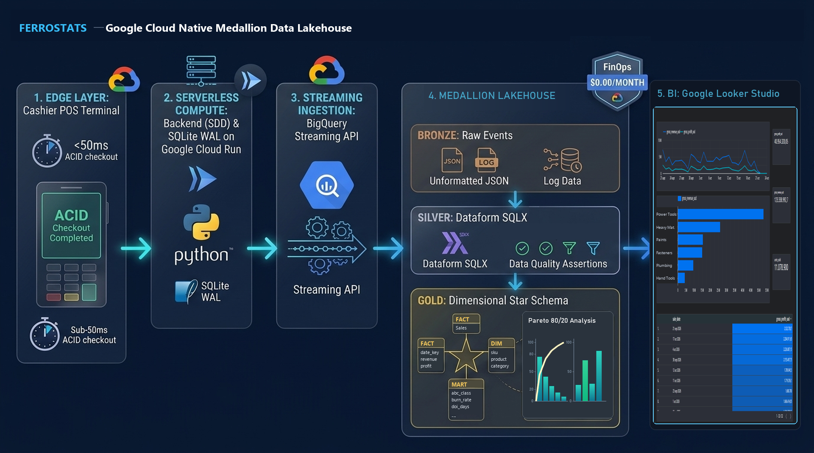
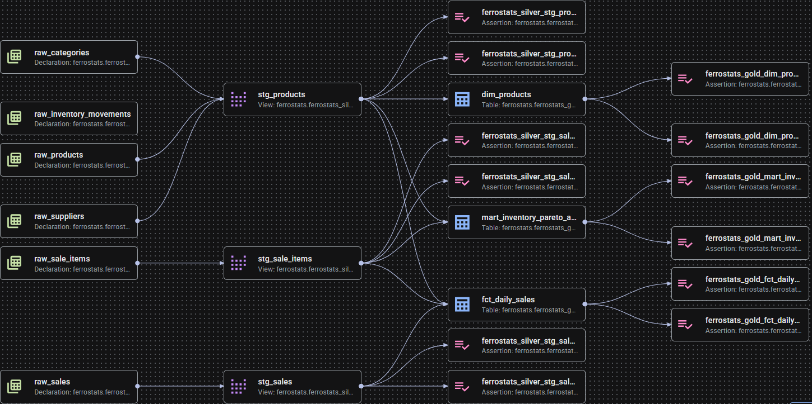
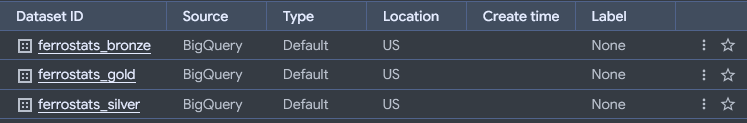
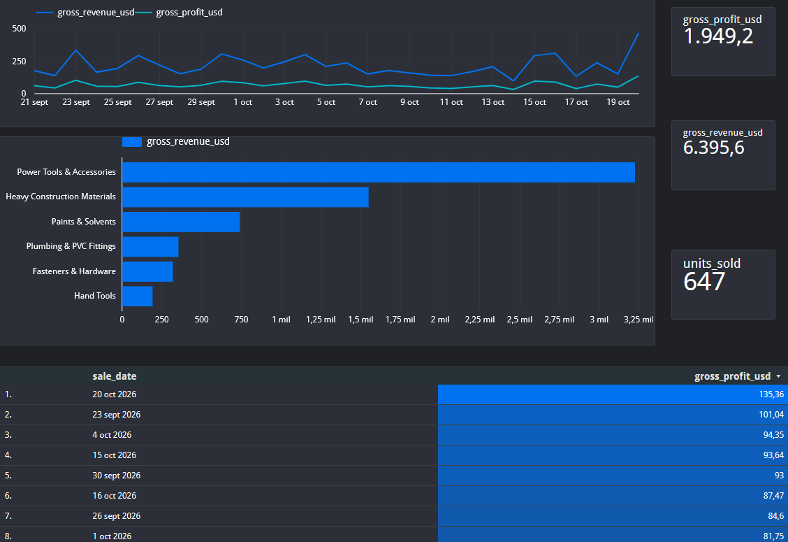
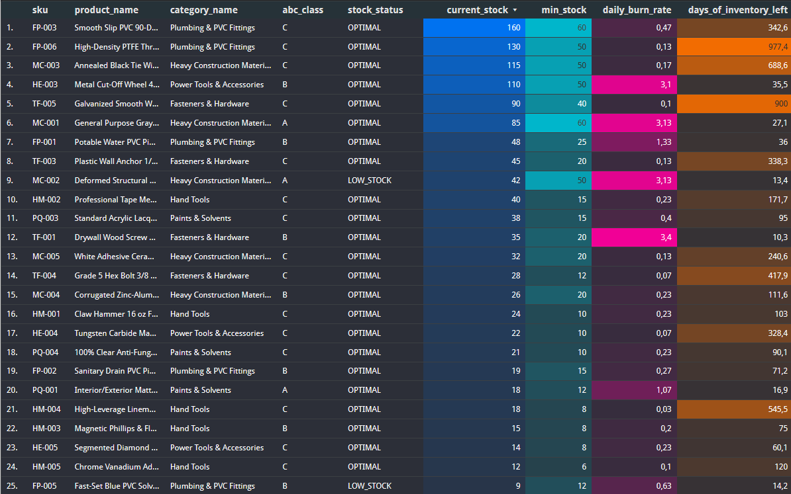
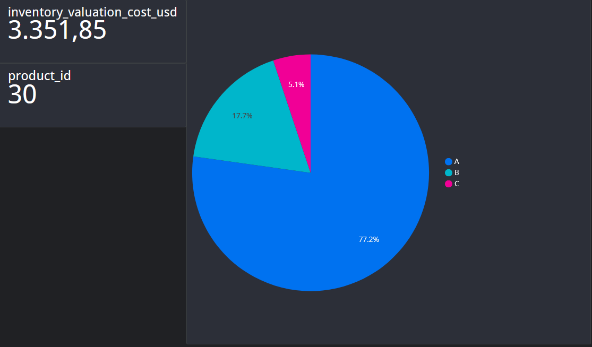
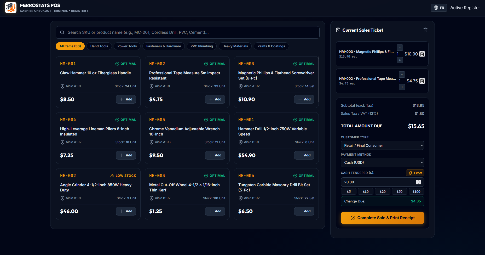
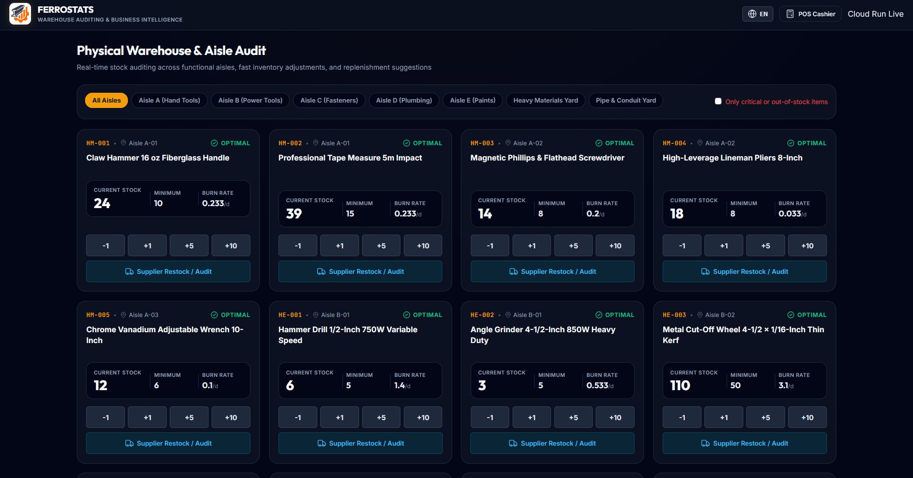

# FERROSTATS — Google Cloud Medallion Data Lakehouse (BigQuery + Dataform SQLX) & Streaming Ingestion Pipeline

<p align="center">
  
</p>

<p align="center">
  <strong>Data Engineering Portfolio Project: Automated Medallion Data Lakehouse (Bronze / Silver / Gold) in Google BigQuery, Declarative SQLX Orchestration with Google Dataform, Analytical Window Modeling (80/20 Pareto, DOI, ROP), and Permanent $0.00/mo FinOps Governance.</strong>
</p>

<p align="center">
  <a href="https://www.credly.com/badges/e27fea72-5eaf-47ee-a43c-43faa3a8fb10"></a>
  <a href="https://cloud.google.com/bigquery"></a>
  <a href="https://cloud.google.com/dataform"></a>
  <a href="https://lookerstudio.google.com/"></a>
  <a href="finops/gcp_free_tier_policy.json"></a>
  <a href="https://www.python.org/"></a>
</p>

<p align="center">
  <strong>Language / Idioma:</strong> <strong>English</strong> | <a href="README.es.md">Versión en Español</a>
</p>

> [!IMPORTANT]
> **Data Engineering Focus & Role of the Web Simulator:**  
> This repository is a **Data Engineering & Cloud Architecture** project. The core deliverables are the **Google BigQuery Medallion Lakehouse (`ferrostats_bronze` $\to$ `ferrostats_silver` $\to$ `ferrostats_gold`)**, the **Google Dataform SQLX pipeline & Data Quality assertions**, the **analytical SQL window functions (Pareto 80/20, Burn Rate, DOI, ROP)**, and the **$0.00/mo GCP FinOps architecture**.  
> Because a streaming data pipeline requires an upstream transactional source, a lightweight web simulator (`/pos` and `/`) was generated via **Spec-Driven Development (SDD)** strictly to act as a **synthetic OLTP event producer** feeding live sales and inventory movements into BigQuery Bronze.

---

## Cloud Data Platform & Live Resources

| Data Platform Layer | Resource / Live Link | Technical Scope |
|---|---|---|
| **1. Analytical BI Layer (Looker Studio)** | [**Official FERROSTATS 3-Page Looker Studio Report**](https://datastudio.google.com/reporting/2389e684-fc9b-431d-9c56-487b3067eb87/page/p_dwbfqrtk8d) | Connected natively to BigQuery Gold Star Schema marts (`fct_daily_sales`, `mart_inventory_pareto_abc`, `dim_products`). |
| **2. Cloud Data Lakehouse (GCP)** | **Project:** `ferrostats` (`US` / `us-central1`)<br>**Dataform Repo:** `ferrostats-pipeline` (`main-workspace`) | **Bronze:** 7 raw immutable tables<br>**Silver:** 3 SQLX curated views + DQ assertions<br>**Gold:** 3 Star Schema analytical tables |
| **3. Upstream OLTP Event Producer (Cloud Run)** | [**POS Transaction Producer (`/pos`)**](https://ferrostats-bi-platform-s72yk4nsvq-uc.a.run.app/pos) • [**Inventory Audit & ROP View (`/`)**](https://ferrostats-bi-platform-s72yk4nsvq-uc.a.run.app) | Scale-to-zero edge simulator (`<50 ms` ACID SQLite WAL + UUID idempotency) that streams live events into `ferrostats_bronze`. |

---

## 1. Architecture & Data Lineage (OLTP Edge $\to$ BigQuery Medallion $\to$ BI)

```mermaid
flowchart TD
    subgraph SOURCE["1. Upstream OLTP Event Producer (Cloud Run Edge — $0.00/mo)"]
        SIM["Synthetic Retail Event Producer (/pos & /)\n- Deterministic Seed (180 Sales, 30 SKUs)\n- SQLite WAL BEGIN IMMEDIATE Lock (<50 ms)\n- Guarded Stock Decrement & UUID Idempotency"]
        STREAM["Async REST Ingestion Client (bigquery_sync.py)\n- Internal GCP Metadata OAuth Token Minting\n- Zero Heavy SDK Bloat (Python urllib.request)"]
    end

    subgraph LAKEHOUSE["2. Google BigQuery Medallion Data Lakehouse ($0.00/mo Free Tier)"]
        subgraph BRONZE["Bronze Layer (ferrostats_bronze — 7 Immutable Raw Tables)"]
            B1["raw_sales (180+ txns)\nraw_sale_items (271+ lines)"]
            B2["raw_products (30 SKUs)\nraw_categories (6) & raw_suppliers (6)"]
            B3["raw_inventory_movements (294+ logs)\nraw_users (4)"]
        end

        subgraph SILVER["Silver Layer (ferrostats_silver — 3 Dataform SQLX Views & Assertions)"]
            S1["stg_sales\n- SAFE.PARSE_TIMESTAMP\n- QUALIFY ROW_NUMBER() Deduplication\n- Assertions: uniqueKey, nonNull, total >= 0"]
            S2["stg_sale_items\n- Historical COGS & Line Profit Math\n- QUALIFY ROW_NUMBER() Deduplication\n- Assertions: quantity > 0, subtotal >= 0"]
            S3["stg_products\n- Enriched Catalog + Lead Time\n- Canonical stock_status (OPTIMAL, LOW_STOCK, OUT_OF_STOCK)\n- Assertions: price >= cost, stock >= 0"]
        end

        subgraph GOLD["Gold Layer (ferrostats_gold — 3 Materialized Star Schema Marts)"]
            G1["fct_daily_sales\nDaily grain by (date_key, category_code)\nGross Revenue, COGS, Profit & Margin %"]
            G2["mart_inventory_pareto_abc\nRolling 30d Window Functions:\n80/20 ABC Class, Burn Rate, DOI & ROP"]
            G3["dim_products\nConformed SKU-to-Name Catalog Dimension\nUnit Margins, Suppliers & Aisle Locations"]
        end
    end

    subgraph BI["3. Business Intelligence & Consumption Layer"]
        LOOKER["Google Looker Studio (3-Page Executive Dashboard)\n- Page 1: Revenue, COGS & Gross Margin Evolution\n- Page 2: 80/20 Pareto Matrix, Burn Rate & Replenishment Priority\n- Page 3: Working Capital Valuation by ABC Class"]
    end

    SIM -->|Commit Event| STREAM
    STREAM -->|tabledata.insertAll| BRONZE
    BRONZE -->|Dataform SQLX Compilation| SILVER
    SILVER -->|Star Schema Materialization| GOLD
    GOLD -->|Native BigQuery Connector| LOOKER
```

<p align="center">
  
</p>



---

## 2. Medallion Lakehouse Engineering in Google BigQuery & Dataform

The core of the project resides in [`dataform/`](dataform/) and [`app/etl/`](app/etl/), implementing a three-tier Medallion architecture orchestrated via declarative **SQLX**:

### 2.1 Layer Breakdown (`Bronze` $\to$ `Silver` $\to$ `Gold`)

| Layer | BigQuery Dataset | Object Name & Type | Grain & Transformations | Data Quality Assertions (`ferrostats_assertions`) |
|---|---|---|---|---|
| **Bronze** | `ferrostats_bronze` | `raw_sales`<br>`raw_sale_items`<br>`raw_products`<br>`raw_categories`<br>`raw_suppliers`<br>`raw_inventory_movements`<br>`raw_users`<br>*(7 Raw Tables)* | Append-only landing tables populated via REST streaming ([`bigquery_sync.py`](app/etl/bigquery_sync.py)) and batch sync ([`sync_sqlite_to_bigquery.py`](scripts/sync_sqlite_to_bigquery.py)). Preserves immutable historical cost/price snapshots. | Schema enforcement on ingestion. |
| **Silver** | `ferrostats_silver` | [`stg_sales.sqlx`](dataform/definitions/silver/stg_sales.sqlx)<br>*(View)* | 1 row per `sale_id`. Type casting (`INT64`, `FLOAT64`, `TIMESTAMP`), `date_key` extraction, net margin derivation, and streaming deduplication via `QUALIFY ROW_NUMBER() OVER (PARTITION BY sale_id ORDER BY sale_timestamp DESC) = 1`. | `uniqueKey: ["sale_id"]`<br>`nonNull: ["sale_id", "transaction_uuid", "sale_timestamp", "total_amount_usd"]`<br>`rowConditions: ["total_amount_usd >= 0", "total_cost_usd >= 0"]` |
| **Silver** | `ferrostats_silver` | [`stg_sale_items.sqlx`](dataform/definitions/silver/stg_sale_items.sqlx)<br>*(View)* | 1 row per `sale_item_id`. Computes historical line COGS (`quantity * unit_cost_snapshot_usd`) and line gross profit (`subtotal_usd - item_cogs_usd`) with `QUALIFY ROW_NUMBER()` deduplication. | `uniqueKey: ["sale_item_id"]`<br>`nonNull: ["sale_item_id", "sale_id", "product_id", "quantity"]`<br>`rowConditions: ["quantity > 0", "subtotal_usd >= 0"]` |
| **Silver** | `ferrostats_silver` | [`stg_products.sqlx`](dataform/definitions/silver/stg_products.sqlx)<br>*(View)* | 1 row per `product_id`. Joins `raw_products` with deduplicated `raw_categories` and `raw_suppliers`, computes unit margin, and standardizes `stock_status` (`OUT_OF_STOCK`, `LOW_STOCK`, `OPTIMAL`). | `uniqueKey: ["product_id"]`<br>`nonNull: ["product_id", "sku", "product_name", "unit_cost_usd", "unit_price_usd"]`<br>`rowConditions: ["unit_cost_usd > 0", "unit_price_usd >= unit_cost_usd", "current_stock >= 0"]` |
| **Gold** | `ferrostats_gold` | [`fct_daily_sales.sqlx`](dataform/definitions/gold/fct_daily_sales.sqlx)<br>*(Table)* | 1 row per `(date_key, category_code)`. Pre-aggregates daily transactions, units sold, `gross_revenue_usd`, `cogs_usd`, `gross_profit_usd`, and `gross_margin_pct` for sub-second Looker Studio time series. | `uniqueKey: ["date_key", "category_code"]`<br>`nonNull: ["date_key", "category_code", "gross_revenue_usd"]` |
| **Gold** | `ferrostats_gold` | [`mart_inventory_pareto_abc.sqlx`](dataform/definitions/gold/mart_inventory_pareto_abc.sqlx)<br>*(Table)* | 1 row per `product_id`. Computes 30-day rolling revenue, cumulative Pareto % (`abc_class` `A`/`B`/`C`), `daily_burn_rate`, `days_of_inventory_left` (DOI), `recommended_reorder_qty` (ROP), and inventory valuation at cost/retail. | `uniqueKey: ["product_id"]`<br>`nonNull: ["product_id", "sku", "abc_class", "stock_status"]` |
| **Gold** | `ferrostats_gold` | [`dim_products.sqlx`](dataform/definitions/gold/dim_products.sqlx)<br>*(Table)* | 1 row per `product_id`. Conformed catalog dimension mapping `sku` business keys to English `product_name`, `category_name`, `supplier_name`, `aisle_location`, and `catalog_margin_pct`. | `uniqueKey: ["product_id"]`<br>`nonNull: ["sku", "product_name", "category_name"]` |

---

## 3. Analytical SQL: 80/20 Pareto Window Functions, DOI & Reorder Point (ROP)

In [`dataform/definitions/gold/mart_inventory_pareto_abc.sqlx`](dataform/definitions/gold/mart_inventory_pareto_abc.sqlx), supply chain indicators are computed dynamically in BigQuery without hardcoded category thresholds:

### 3.1 Monotonic Cumulative Revenue Window (`ROWS BETWEEN UNBOUNDED PRECEDING AND CURRENT ROW`)
```sql
WITH pareto_calc AS (
  SELECT
    b.*,
    SUM(b.revenue_30d_usd) OVER() AS total_revenue_all,
    SUM(b.revenue_30d_usd) OVER(
      ORDER BY b.revenue_30d_usd DESC, b.units_sold_30d DESC, b.product_id ASC
      ROWS BETWEEN UNBOUNDED PRECEDING AND CURRENT ROW
    ) AS running_revenue
  FROM
    products_base b
),
pareto_enriched AS (
  SELECT
    pc.*,
    ROUND(SAFE_DIVIDE(pc.running_revenue, NULLIF(pc.total_revenue_all, 0)) * 100.0, 2) AS cumulative_rev_pct,
    ROUND(pc.units_sold_30d / 30.0, 3) AS daily_burn_rate
  FROM
    pareto_calc pc
)
SELECT
  product_id, sku, product_name, category_name, aisle_location,
  current_stock, min_stock, stock_status,
  cumulative_rev_pct,
  CASE
    WHEN cumulative_rev_pct <= 80.0 THEN 'A'
    WHEN cumulative_rev_pct <= 95.0 THEN 'B'
    ELSE 'C'
  END AS abc_class
FROM pareto_enriched;
```
> **Why `ROWS BETWEEN UNBOUNDED PRECEDING AND CURRENT ROW` with tie-breaking?**  
> In BigQuery Standard SQL, an `ORDER BY` inside `SUM() OVER()` defaults to `RANGE`, which groups tied revenue values together into a single jump. Explicitly specifying `ROWS` with a deterministic tie-breaker (`units_sold_30d DESC, product_id ASC`) guarantees a strictly monotonic cumulative curve across all 30 SKUs.

### 3.2 Burn Rate, Days of Inventory (DOI), and Lead-Time Reorder Point (ROP)
$$\text{Daily Burn Rate} = \frac{\text{Units Sold (30d)}}{30.0}, \qquad \text{DOI (Days)} = \frac{\text{Current Stock}}{\text{Daily Burn Rate}}$$

$$\text{Recommended Reorder Qty} = \max\Big(\text{Min Stock} + \lceil\text{Burn Rate} \times \text{Lead Time}\rceil + \lceil\text{Burn Rate} \times 15\rceil - \text{Current Stock},\; \text{Min Stock},\; 5\Big)$$

When `current_stock <= min_stock`, the formula automatically scales the replenishment order to cover the minimum threshold, expected demand during the supplier's delivery lead time (`lead_time_days`), and a **15-day safety buffer**.

---

## 4. OLTP-to-OLAP Ingestion Integrity & FinOps Engineering ($0.00/mo)

### 4.1 Edge Concurrency & Idempotency Rules ([`app/api/routes_pos.py`](app/api/routes_pos.py))
- **Immediate Write Serialization (`BEGIN IMMEDIATE`):** Prevents `SQLITE_BUSY` read-to-write upgrade deadlocks under concurrent requests.
- **Guarded Atomic Stock Decrement (`0%` Overselling):**
  ```sql
  UPDATE products
  SET current_stock = current_stock - ?, updated_at = ?
  WHERE product_id = ? AND current_stock >= ?;
  ```
  If `cursor.rowcount == 0`, the transaction triggers an immediate `ROLLBACK` and returns `HTTP 409 Conflict`.
- **UUID Idempotency Replay:** Every transaction requires a client `transaction_uuid`. Retrying a committed UUID returns `HTTP 200 OK` with `Idempotent-Replay: true` without double-decrementing stock or emitting duplicate rows to BigQuery.

### 4.2 Permanent $0.00 USD/Month GCP FinOps Architecture ([`finops/gcp_free_tier_policy.json`](finops/gcp_free_tier_policy.json))
By replacing persistent Cloud SQL instances (~$25/mo) and Serverless VPC Connectors (~$15/mo) with scale-to-zero Cloud Run containers, metadata OAuth tokens, and BigQuery Free Tier datasets, the platform saves **~$40/month** and runs permanently at **$0.00/mo**:

| GCP Service | Always Free Tier Limit | FERROSTATS Footprint | Billed Cost |
|---|---|---|:---:|
| **Google BigQuery** | 10 GB storage + 1 TB query scan / mo | < 50 MB storage + < 25 MB scan / mo (pre-aggregated Gold tables) | **$0.00 USD** |
| **Google Dataform** | Free SQLX repositories & workspaces | 1 repository (`ferrostats-pipeline`) | **$0.00 USD** |
| **Google Looker Studio** | Free BI reporting & native connector | 3-page dashboard connected to `ferrostats_gold` | **$0.00 USD** |
| **Google Cloud Run** | 2M requests + 360,000 vCPU-sec / mo | ~15,000 req/mo (`--min-instances 0`, `<3 s` cold start) | **$0.00 USD** |
| **Google Artifact Registry** | 0.5 GB container storage / mo | Kept `< 0.3 GB` via automated image digest pruning in `deploy_gcp.ps1` | **$0.00 USD** |
| **Cloud SQL & VPC Connectors** | *Prohibited (Fixed hourly billing)* | Replaced by edge SQLite WAL + IAM metadata REST streaming | **$0.00 USD** |

---

## 5. Engineering Authorship & Spec-Driven Development (SDD) Transparency

To clearly distinguish **Data Engineering ownership** from **AI-assisted frontend scaffolding**, the table below documents how each layer of the repository was built:

| Layer / Component | Engineering Ownership | Implementation Details |
|---|---|---|
| **BigQuery Medallion Architecture (`Bronze` / `Silver` / `Gold`)** | **100% Designed & Engineered by Author**<br>*(Diego Alejandro Escobar Barahona)* | Dataset topology, table grains, `QUALIFY ROW_NUMBER()` deduplication, and Star Schema modeling (`fct_daily_sales`, `mart_inventory_pareto_abc`, `dim_products`). |
| **Dataform SQLX DAG, Assertions & Analytical Window SQL** | **100% Engineered by Author**<br>*(Diego Alejandro Escobar Barahona)* | Declarative `.sqlx` definitions, `uniqueKey`/`nonNull`/`rowConditions` quality gates, and 80/20 Pareto / Burn Rate / DOI / ROP window formulas. |
| **GCP FinOps Policy, IAM Metadata Streaming & Cloud Deployment** | **100% Engineered by Author**<br>*(Diego Alejandro Escobar Barahona)* | Zero-cost architecture design, metadata OAuth REST ingestion (`bigquery_sync.py`), Artifact Registry pruning (`deploy_gcp.ps1`), and Looker Studio dashboard. |
| **OLTP Data Contracts, 3NF Schema & ACID Concurrency Rules** | **Specified by Author via SDD ([`specs/`](specs/))**<br>+ *Verified via Automated QA (`smoke_test.py`)* | Formal specification of 3NF tables, `BEGIN IMMEDIATE` locking, guarded stock updates, and `transaction_uuid` idempotency. |
| **Web Simulator UI (`app/static/*.html`, `*.js`, `*.css`)** | **SDD + AI-Generated Scaffolding**<br>*(Governed by [`spec_05`](specs/spec_05_commit_5_frontend_bi_pos_and_mobile.md))* | Because the author's focus is **Data Engineering** (not frontend web design), the HTML/CSS/JS views were generated from formal specs strictly to serve as a visual event generator for the pipeline. |

---

## 6. Data Platform & Pipeline Visual Showcase

| Pipeline Stage | Technical Preview |
|---|---|
| **1. Google Cloud Dataform (SQLX DAG)**<br>*Compiled Medallion dependency graph (`raw_*` $\to$ `stg_*` $\to$ Gold marts & assertions)* |  |
| **2. Google BigQuery Data Warehouse**<br>*`ferrostats_bronze` (7 raw tables), `ferrostats_silver` (3 views), and `ferrostats_gold` (3 Star Schema marts)* |  |
| **3. Looker Studio BI — Page 1 (Sales Fact)**<br>*Powered by `ferrostats_gold.fct_daily_sales`: Revenue, COGS, and gross margin trends* |  |
| **4. Looker Studio BI — Page 2 (Pareto & DOI)**<br>*Powered by `ferrostats_gold.mart_inventory_pareto_abc`: 80/20 ABC matrix, Burn Rate & DOI* |  |
| **5. Looker Studio BI — Page 3 (Capital Valuation)**<br>*Powered by `dim_products` & `mart_inventory_pareto_abc`: Working capital valuation by ABC class* |  |
| **6. Upstream Source A — POS Event Producer (`/pos`)**<br>*Synthetic OLTP checkout generator streaming sales into `ferrostats_bronze.raw_sales`* |  |
| **7. Upstream Source B — Inventory & ROP Monitor (`/`)**<br>*Aisle stock audit and replenishment priority table streaming movements into `raw_inventory_movements`* |  |

---

## 7. Repository Structure (Data Engineering First)

```text
ferrostats/
├── dataform/                      # [CORE] Google Cloud Dataform Medallion Pipeline (SQLX)
│   ├── definitions/
│   │   ├── sources/               # 7 BigQuery Bronze source declarations (sources.js)
│   │   ├── silver/                # 3 Silver views + DQ assertions (stg_sales, stg_sale_items, stg_products)
│   │   └── gold/                  # 3 Gold Star Schema marts (fct_daily_sales, mart_inventory_pareto_abc, dim_products)
│   ├── package.json               # Dataform dependency configuration
│   └── workflow_settings.yaml     # GCP project (ferrostats) and dataset defaults (US)
├── scripts/                       # [CORE] Cloud Synchronization, Compilation & FinOps Automation
│   ├── sync_sqlite_to_bigquery.py # Batch extraction & ingestion from local OLTP to BigQuery Bronze
│   ├── deploy_dataform_models.py  # Compiles Silver views & Gold Star Schema tables in BigQuery
│   ├── sync_dataform_to_gcp.py    # Pushes SQLX definitions to GCP Dataform workspace via REST API
│   ├── smoke_test.py              # End-to-end HTTP & UUID idempotency verification suite
│   ├── verify_zero_cost.ps1       # Automated GCP FinOps quota & billing auditor
│   └── emergency_kill_switch.ps1  # Instant service scale-down for billing contingencies
├── data/
│   └── seeds/                     # Master deterministic English CSV seeds (30 SKUs, 6 categories, 6 suppliers)
├── app/
│   ├── etl/
│   │   ├── bigquery_sync.py       # Asynchronous REST streaming client into BigQuery Bronze
│   │   └── local_pipeline.py      # Local Star Schema compiler & 6 Data Quality assertions
│   ├── db/
│   │   ├── schema_oltp.sql        # 3NF transactional database DDL
│   │   ├── schema_olap.sql        # Local Star Schema analytical DDL
│   │   └── seed_loader.py         # Deterministic synthetic generator (180 historical sales, Seed=2026)
│   ├── api/                       # FastAPI Ingestion & Observability Endpoints
│   └── static/                    # SDD Synthetic Event Producer UI (POS & Warehouse Simulator)
├── finops/
│   └── gcp_free_tier_policy.json  # Machine-readable $0.00/mo FinOps guardrails
├── specs/                         # Formal Spec-Driven Development (SDD) Architectural Blueprints (01–07)
└── deploy_gcp.ps1                 # Scale-to-zero Cloud Run deployment & Artifact Registry pruning
```

---

## 8. Quickstart: Run the ETL & Sync to Google BigQuery

```bash
# 1. Install dependencies
pip install --no-cache-dir -r requirements.txt

# 2. Generate deterministic 30-SKU catalog, 180 historical sales & run local DQ assertions
python -m app.db.seed_loader

# 3. Synchronize raw tables to BigQuery Bronze & compile Silver/Gold Dataform models
python scripts/sync_sqlite_to_bigquery.py
python scripts/deploy_dataform_models.py
python scripts/sync_dataform_to_gcp.py

# 4. (Optional) Launch the local event producer server & run idempotency smoke tests
python -m uvicorn app.main:app --host 0.0.0.0 --port 8080
python scripts/smoke_test.py
```

---

## 9. Author & Contact

- **Author:** Diego Alejandro Escobar Barahona — *Data Engineer*
- **Certification:** [Google Cloud Certified — Associate Data Practitioner](https://www.credly.com/badges/e27fea72-5eaf-47ee-a43c-43faa3a8fb10) (Credential ID: `23e3584a246f4c149f26fea03cebcbbb`)
- **LinkedIn:** [linkedin.com/in/diego-escobar-459256394](https://linkedin.com/in/diego-escobar-459256394)
- **Email:** `diegoalejandroescobarahona1@gmail.com`
- **License:** [MIT License](LICENSE)
