# FERROSTATS — Decoupled OLTP-to-OLAP Streaming Pipeline & Medallion Data Lakehouse on Google Cloud

<p align="center">
  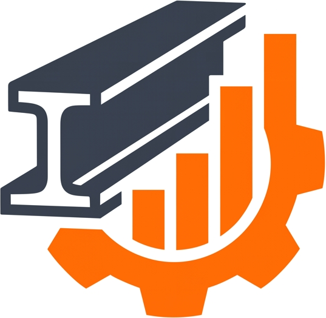
</p>

<p align="center">
  <strong>Data Engineering Portfolio Project: Serverless OLTP-to-OLAP Streaming Ingestion, Automated Medallion Data Lakehouse (Google BigQuery + Dataform SQLX), Dynamic 80/20 Pareto Inventory Analytics, and $0.00/mo FinOps Governance.</strong>
</p>

<p align="center">
  <a href="https://www.credly.com/badges/e27fea72-5eaf-47ee-a43c-43faa3a8fb10"></a>
  <a href="https://cloud.google.com/bigquery"></a>
  <a href="https://cloud.google.com/dataform"></a>
  <a href="https://lookerstudio.google.com/"></a>
  <a href="https://cloud.google.com/run"></a>
  <a href="finops/gcp_free_tier_policy.json"></a>
  <a href="https://fastapi.tiangolo.com/"></a>
  <a href="https://www.sqlite.org/wal.html"></a>
</p>

<p align="center">
  <strong>Language / Idioma:</strong> <strong>English</strong> | <a href="README.es.md">Versión en Español</a>
</p>

> [!NOTE]
> **Data Engineering Portfolio Scope & Synthetic Workload:** This repository showcases an end-to-end **Data Engineering & Cloud Lakehouse Architecture** operating at a permanent **$0.00 USD/month** cost on Google Cloud Platform. All catalog SKUs, inventory movements, and POS transactions are synthetically generated (deterministic seed of 180 historical sales across 30 hardware SKUs). The web interfaces (`/` and `/pos`) serve as **interactive edge event producers** built via **Spec-Driven Development (SDD)** to generate real-time transactional streams into the BigQuery Medallion pipeline.

---

## Live Cloud Endpoints (Google Cloud Platform)

| Component | Live URL / Resource | Architectural Role |
|---|---|---|
| **Looker Studio Executive BI** | [Official FERROSTATS Analytics Report](https://datastudio.google.com/reporting/2389e684-fc9b-431d-9c56-487b3067eb87/page/p_dwbfqrtk8d) | 3-page BI reporting suite querying BigQuery Gold Star Schema marts (`fct_daily_sales`, `mart_inventory_pareto_abc`, `dim_products`). |
| **Warehouse Audit & BI Portal** | [https://ferrostats-bi-platform-s72yk4nsvq-uc.a.run.app](https://ferrostats-bi-platform-s72yk4nsvq-uc.a.run.app) | Edge inventory adjustment producer, physical aisle stock monitor, and embedded Looker BI portal. |
| **POS Edge Event Producer** | [https://ferrostats-bi-platform-s72yk4nsvq-uc.a.run.app/pos](https://ferrostats-bi-platform-s72yk4nsvq-uc.a.run.app/pos) | Sub-50ms ACID checkout simulator that produces live transactional events into `ferrostats_bronze`. |
| **Swagger / OpenAPI 3.0** | [https://ferrostats-bi-platform-s72yk4nsvq-uc.a.run.app/docs](https://ferrostats-bi-platform-s72yk4nsvq-uc.a.run.app/docs) | Interactive REST API data contracts, idempotency payloads, and observability endpoints. |
| **Executive Architecture Deck** | [https://ferrostats-bi-platform-s72yk4nsvq-uc.a.run.app/presentacion](https://ferrostats-bi-platform-s72yk4nsvq-uc.a.run.app/presentacion) | Interactive slide deck detailing the Medallion DAG and FinOps engineering. |
| **GCP Project & Dataform** | `ferrostats` (`us-central1`) | Dataform Repository: `ferrostats-pipeline` (`main-workspace`) • Datasets: `ferrostats_bronze`, `ferrostats_silver`, `ferrostats_gold`. |

---

## Engineering Authorship & Spec-Driven Development (SDD) Transparency

As a **Data Engineering & Cloud Architecture** project, this repository maintains strict transparency regarding what was architected and engineered directly by the author versus where **Spec-Driven Development (SDD)** and AI-assisted code generation were used as an implementation accelerator (specifically for the HTML/CSS/JS web interfaces, since full-stack web design is not the primary focus of this portfolio):

| Engineering Domain | Ownership & Execution Model | Technical Deliverables |
|---|---|---|
| **Cloud Data Architecture & Medallion Design** | **100% Human-Architected**<br>*(Diego Alejandro Escobar Barahona)* | Decoupled OLTP-to-OLAP topology, Google BigQuery dataset partitioning (`ferrostats_bronze`, `ferrostats_silver`, `ferrostats_gold`), and Star Schema dimensional modeling (`fct_daily_sales`, `mart_inventory_pareto_abc`, `dim_products`). |
| **Dataform SQLX Pipelines & Analytical SQL** | **100% Human-Engineered**<br>*(Diego Alejandro Escobar Barahona)* | Declarative SQLX DAG orchestration, automated Data Quality assertions (`uniqueKey`, `nonNull`, `rowConditions`), dynamic 80/20 Pareto window functions, Daily Burn Rate, Days of Inventory (DOI), and Reorder Point (ROP) formulas. |
| **FinOps Governance ($0.00/mo Free Tier)** | **100% Human-Architected**<br>*(Diego Alejandro Escobar Barahona)* | Replacement of billable Cloud SQL & VPC Connectors with scale-to-zero Cloud Run containers, internal GCP metadata OAuth token minting, and automated Artifact Registry digest pruning (<0.3 GB). |
| **OLTP Data Contracts, ACID & Idempotency Rules** | **Human-Specified via SDD** ([`specs/`](specs/))<br>+ *Verified in Python/SQLite WAL* | 3NF relational schema, `BEGIN IMMEDIATE` write locks, atomic guarded stock decrements (`current_stock >= :qty`), and `transaction_uuid` idempotency replay guarantees. |
| **Web Frontend UI (`app/static/*.html`, `*.js`, `*.css`)** | **SDD + AI-Assisted Scaffolding**<br>*(Directed via [`spec_05`](specs/spec_05_commit_5_frontend_bi_pos_and_mobile.md))* | Single-Page Application (SPA) interfaces for the POS cashier terminal and warehouse aisle monitor, generated from formal specifications to serve as visual event producers for the data pipeline. |

### Specifications Traceability Matrix (`specs/`)

Prior to application scaffolding, 7 formal architectural specifications were authored to enforce data contracts, schema invariants, and FinOps guardrails:

| Spec | Target Phase & Scope | Architectural Deliverables & Data Engineering Competencies | Status |
|:---:|---|---|:---:|
| [**Spec 01**](specs/spec_01_commit_1_architecture_and_gcp_finops.md) | **System Architecture & FinOps Guardrails** | Decoupled OLTP-ETL-OLAP blueprint, Google Cloud Free Tier budget limits ($0.00 actual), elimination of fixed-cost services (Cloud SQL, VPC Connectors). | `Verified` |
| [**Spec 02**](specs/spec_02_commit_2_data_model_and_synthetic_seed.md) | **Data Modeling & Synthetic Seeds** | 3NF Transactional Schema (6 tables), Dimensional Star Schema (Fact + Dimensions), deterministic hardware store synthetic dataset (180 transactions, 30 SKUs). | `Verified` |
| [**Spec 03**](specs/spec_03_commit_3_etl_pipeline_and_data_quality.md) | **BigQuery Medallion & Data Quality** | Dataform SQLX pipeline (Bronze raw stream $\to$ Silver curated staging $\to$ Gold star marts), automated quality assertions (`uniqueKey`, `nonNull`, `rowConditions`). | `Verified` |
| [**Spec 04**](specs/spec_04_commit_4_backend_api_and_acid_pos.md) | **Ingestion API & ACID Edge Engine** | Sub-50ms edge checkout, `BEGIN IMMEDIATE` locks, UUID idempotency, guarded stock decrements (`current_stock >= :qty`), asynchronous BigQuery Bronze streaming. | `Verified` |
| [**Spec 05**](specs/spec_05_commit_5_frontend_bi_pos_and_mobile.md) | **Event Producer Portals & Embedded BI** | SDD frontend specification for the POS event generator, warehouse aisle audit view (`Aisle A-01`..`E-03`), and embedded 3-page Looker Studio report. | `Verified` |
| [**Spec 06**](specs/spec_06_commit_6_gcp_deploy_docker_and_qa.md) | **Containerization & GCP Deployment** | Multi-stage `python:3.11-slim` Docker container (~130 MB), scale-to-zero Cloud Run deployment scripts (`deploy_gcp.ps1` / `deploy_gcp.sh`), HTTP smoke test suite (`scripts/smoke_test.py`). | `Verified` |
| [**Spec 07**](specs/spec_07_commit_7_gcp_serverless_free_tier_production_policy.md) | **FinOps Governance & Kill-Switch** | Machine-readable FinOps policy (`gcp_free_tier_policy.json`), Artifact Registry image digest purger (<0.5 GB threshold), emergency billing kill-switch scripts. | `Verified` |

---

## 1. Problem Space & Data Engineering Solution

Small and mid-sized hardware and construction retail stores suffer from three fundamental data and inventory problems:

1. **Unplanned Stockouts on Core Revenue Drivers (Class A SKUs):** Up to 30% of lost sales occur when high-velocity structural materials (Portland cement, corrugated rebar, PVC pipes) run out unexpectedly because reorders are based on guesswork rather than real-time burn rate and supplier lead times.
2. **Trapped Working Capital in Dead Stock (Class C SKUs):** Up to 25% of operating liquidity remains frozen in slow-moving items while high-margin fast movers face stockouts.
3. **OLTP vs. OLAP Contention & Cloud Cost Barriers:** Traditional cloud relational databases (e.g., Cloud SQL, RDS) charge $25–$50+/month in idle compute and IPv4 fees, while running analytical window queries directly on operational tables causes lock contention during checkout.

**FERROSTATS** solves this through a decoupled, zero-cost data architecture:
- **Edge OLTP Ingestion (<50 ms Latency, 0% Overselling):** Transactional checkouts and inventory adjustments are validated locally in SQLite Write-Ahead Logging (WAL) mode using `BEGIN IMMEDIATE` locks, atomic SQL guard clauses, and UUID idempotency keys, then streamed asynchronously into **Google BigQuery Bronze**.
- **Medallion Data Lakehouse in Google BigQuery & Dataform (SQLX):** Raw append-only tables (`ferrostats_bronze`) are curated through declarative Dataform SQLX views (`ferrostats_silver`) with automated Data Quality assertions, and materialized into Star Schema analytical marts (`ferrostats_gold`).
- **Automated Supply Chain Window Analytics:** BigQuery analytical window functions dynamically compute **80/20 Pareto ABC segmentation**, **30-day Daily Burn Rate**, **Days of Inventory (DOI)**, and **Lead-Time Reorder Point (ROP)** with a 15-day safety buffer.
- **Permanent $0.00/mo Serverless FinOps:** Scale-to-zero Cloud Run containers, metadata-based OAuth REST ingestion, and BigQuery/Dataform Free Tier allocations keep monthly infrastructure billing at exactly **$0.00 USD**.

---

## 2. End-to-End Data Architecture

<p align="center">
  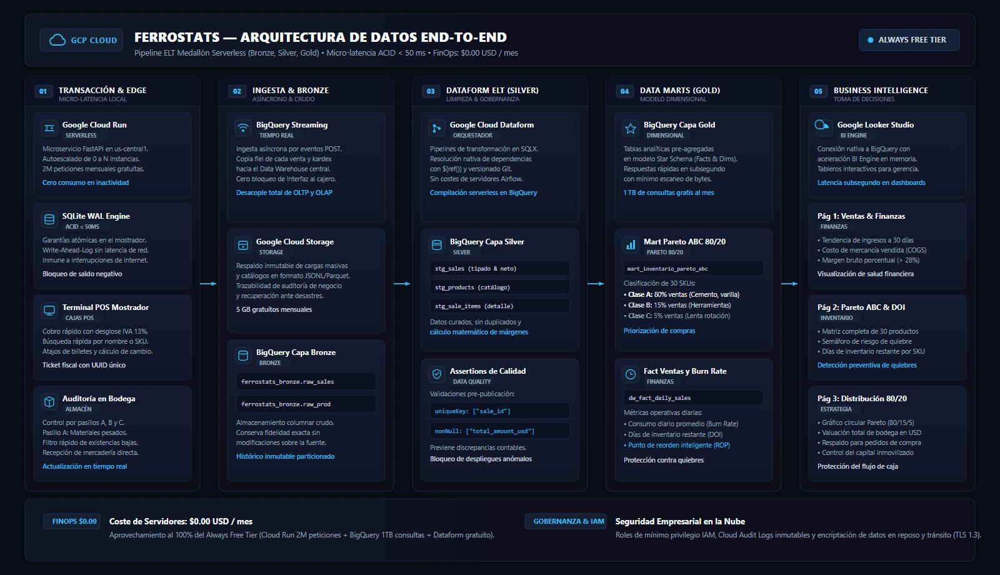
</p>

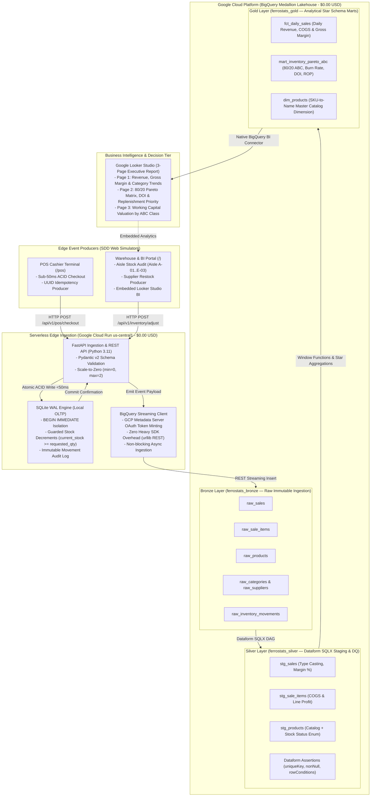

---

## 3. Core Data Engineering Pillars

### 3.1 Decoupled OLTP-to-OLAP Ingestion & Concurrency Control
- **Sub-50ms Edge OLTP:** Cashier checkouts execute against local SQLite in **Write-Ahead Logging (WAL)** mode (`PRAGMA journal_mode = WAL`, `PRAGMA synchronous = NORMAL`), isolating transactional writes from analytical scans.
- **ACID Race Condition Prevention & UUID Idempotency:**
  ```python
  cursor.execute("BEGIN IMMEDIATE TRANSACTION;")
  # 1. Verify transaction_uuid idempotency key (prevents duplicate billing on network retries)
  # 2. Verify stock availability and execute guarded atomic decrement:
  cursor.execute("""
      UPDATE products
      SET current_stock = current_stock - ?, updated_at = ?
      WHERE product_id = ? AND current_stock >= ?;
  """, (qty, now_ts, prod_id, qty))
  if cursor.rowcount == 0:
      conn.execute("ROLLBACK;")
      raise HTTPException(status_code=409, detail="Concurrency conflict: insufficient stock.")
  ```
- **Lightweight IAM Metadata Streaming:** Committed transactions stream asynchronously to BigQuery Bronze (`app/etl/bigquery_sync.py`) using Python's native `urllib.request` authenticated via the Cloud Run internal metadata server (`http://metadata.google.internal/.../token`), keeping container memory well below the 512 MiB serverless ceiling.

### 3.2 Medallion Data Lakehouse in BigQuery & Dataform (SQLX)

| Medallion Layer | BigQuery Dataset | Dataform / Table Objects | Engineering Responsibility |
|---|---|---|---|
| **Bronze (Raw)** | `ferrostats_bronze` | `raw_sales`<br>`raw_sale_items`<br>`raw_products`<br>`raw_categories`<br>`raw_suppliers`<br>`raw_inventory_movements`<br>`raw_users` | Immutable append-only landing zone preserving raw event payloads and historical snapshots. |
| **Silver (Curated)** | `ferrostats_silver` | `stg_sales`<br>`stg_sale_items`<br>`stg_products` | Declarative Dataform SQLX views performing strict type casting (`INT64`, `FLOAT64`, `TIMESTAMP`), string normalization, COGS/profit derivation, and canonical `stock_status` classification (`OPTIMAL`, `LOW_STOCK`, `OUT_OF_STOCK`). |
| **Gold (Marts)** | `ferrostats_gold` | `fct_daily_sales`<br>`mart_inventory_pareto_abc`<br>`dim_products` | Pre-aggregated Star Schema fact and dimension tables optimized for sub-second Looker Studio BI queries. |

#### Automated Data Quality Gates (Dataform Assertions)
- **`uniqueKey` Assertions:** Enforces primary key uniqueness across `stg_sales` (`sale_id`), `stg_sale_items` (`sale_item_id`), `stg_products` (`product_id`), and `fct_daily_sales` (`date_key, category_code`).
- **`nonNull` Assertions:** Blocks incomplete records lacking `transaction_uuid`, `sale_timestamp`, `sku`, `product_name`, or financial amounts.
- **`rowConditions` Assertions:** Enforces domain invariants in SQLX (`unit_cost_usd > 0`, `unit_price_usd >= unit_cost_usd`, `current_stock >= 0`, `quantity > 0`, and `subtotal_usd >= 0`).

---

## 4. Analytical SQL: Dynamic 80/20 Pareto, DOI & Reorder Point (ROP)

The Gold data mart [`dataform/definitions/gold/mart_inventory_pareto_abc.sqlx`](dataform/definitions/gold/mart_inventory_pareto_abc.sqlx) computes inventory health metrics across a rolling 30-day window using BigQuery analytical window functions:

### 4.1 Cumulative 80/20 Pareto Window Function
```sql
WITH pareto_calc AS (
  SELECT
    b.*,
    SUM(b.revenue_30d_usd) OVER() AS total_revenue_all,
    SUM(b.revenue_30d_usd) OVER(
      ORDER BY b.revenue_30d_usd DESC, b.units_sold_30d DESC, b.product_id ASC
      ROWS BETWEEN UNBOUNDED PRECEDING AND CURRENT ROW
    ) AS running_revenue
  FROM
    products_base b
),
pareto_enriched AS (
  SELECT
    pc.*,
    ROUND(SAFE_DIVIDE(pc.running_revenue, NULLIF(pc.total_revenue_all, 0)) * 100.0, 2) AS cumulative_rev_pct,
    ROUND(pc.units_sold_30d / 30.0, 3) AS daily_burn_rate
  FROM
    pareto_calc pc
)
SELECT
  product_id, sku, product_name, category_name, aisle_location,
  current_stock, min_stock, stock_status,
  cumulative_rev_pct,
  CASE
    WHEN cumulative_rev_pct <= 80.0 THEN 'A'
    WHEN cumulative_rev_pct <= 95.0 THEN 'B'
    ELSE 'C'
  END AS abc_class
FROM pareto_enriched;
```

- **Class A (0%–80% Cumulative Revenue):** High-velocity core SKUs driving 80% of business revenue; prioritized for zero-stockout tolerance.
- **Class B (80%–95% Cumulative Revenue):** Medium-rotation hardware items.
- **Class C (95%–100% Cumulative Revenue):** Slow-moving tail catalog monitored to prevent working-capital lockup.

### 4.2 Daily Burn Rate, Days of Inventory (DOI), and Lead-Time ROP
$$\text{Daily Burn Rate} = \frac{\text{Units Sold in 30 Days}}{30.0}$$

$$\text{Days of Inventory Remaining (DOI)} = \frac{\text{Current Stock}}{\text{Daily Burn Rate}}$$

$$\text{Recommended Reorder Quantity} = \max\Big(\text{Min Stock} + \lceil\text{Burn Rate} \times \text{Lead Time}\rceil + \lceil\text{Burn Rate} \times 15\rceil - \text{Current Stock},\; \text{Min Stock},\; 5\Big)$$

Where $\lceil\text{Burn Rate} \times 15\rceil$ provides a dynamic 15-day safety buffer scaled to each SKU's real demand velocity.

---

## 5. FinOps Engineering: Permanent $0.00 USD/Month Architecture

FERROSTATS enforces a machine-readable **Zero Fixed-Cost Cloud Policy** ([`finops/gcp_free_tier_policy.json`](finops/gcp_free_tier_policy.json)) within Google Cloud's Always Free Tier (~$40/mo saved compared to standard Cloud SQL + VPC Connector setups):

| GCP Service | Always Free Tier Monthly Allowance | FERROSTATS Actual Usage | Monthly Cost |
|---|---|---|:---:|
| **Google Cloud Run** | 2,000,000 requests + 360,000 vCPU-sec | ~15,000 requests (`min-instances = 0`, `<3 s` cold start) | **$0.00 USD** |
| **Google BigQuery** | 10 GB active storage + 1 TB query scan / mo | < 50 MB storage + < 25 MB query scan / mo | **$0.00 USD** |
| **Google Dataform** | Free SQLX repositories, workspaces & DAG runs | 1 repository (`ferrostats-pipeline`) | **$0.00 USD** |
| **Google Looker Studio** | Free BI reporting & native BigQuery connector | 3-page dashboard connected to `ferrostats_gold` | **$0.00 USD** |
| **Google Artifact Registry** | 0.5 GB container image storage / mo | Kept < 0.3 GB via automated digest pruning in `deploy_gcp` | **$0.00 USD** |
| **Cloud SQL (Managed RDBMS)** | *Prohibited (~$15–$25/mo + IPv4 charges)* | Replaced by edge SQLite WAL + BigQuery Bronze streaming | **$0.00 USD** |
| **Serverless VPC Connectors** | *Prohibited (~$14/mo per connector)* | Replaced by IAM service-account metadata OAuth tokens | **$0.00 USD** |
| **TOTAL MONTHLY BILL** | — | — | **$0.00 USD** |

---

## 6. Architectural Defense & System Design Q&A

### Q1: Why pair SQLite WAL on the edge with BigQuery instead of provisioning Cloud SQL PostgreSQL?
> **Answer:** Cloud SQL charges ~$15–$25/month in continuous instance uptime plus static IPv4 fees even at zero traffic. By combining local SQLite in `WAL` mode on scale-to-zero Cloud Run with asynchronous REST streaming into Google BigQuery, the system achieves `<50 ms` transactional checkout latency, zero network roundtrips during point-of-sale locking, complete separation between OLTP and OLAP workloads, and a permanent **$0.00/mo** infrastructure footprint.

### Q2: How does the pipeline guarantee 0% overselling and prevent duplicate transactions?
> **Answer:** Concurrency and idempotency are enforced at four levels:
> 1. `BEGIN IMMEDIATE TRANSACTION` acquires an immediate write lock in SQLite WAL before reading `current_stock`, serializing concurrent checkout requests.
> 2. Stock decrements execute an atomic SQL guard (`UPDATE products SET current_stock = current_stock - :qty WHERE product_id = :id AND current_stock >= :qty`). If `cursor.rowcount == 0`, an instant `ROLLBACK` triggers and returns `HTTP 409 Conflict`.
> 3. Every checkout requires a client-generated `transaction_uuid`. Replaying a committed UUID returns `HTTP 200 OK` with `Idempotent-Replay: true` and the cached receipt without re-decrementing inventory or re-emitting duplicate events.
> 4. In the Lakehouse, Dataform Silver models validate `uniqueKey` assertions on `sale_id`, `sale_item_id`, and `product_id`.

### Q3: Why use SKU codes alongside `dim_products` across POS and BI?
> **Answer:** Following dimensional modeling best practices, short immutable codes (`sku` such as `HM-002`, `MC-001`, `FP-004` and `category_code` such as `HERR_MAN`, `MAT_CONST`) act as language-neutral business keys across operational logs, while [`ferrostats_gold.dim_products`](dataform/definitions/gold/dim_products.sqlx) serves as the canonical catalog dimension mapping every `sku` to its standardized English `product_name`, `category_name`, `aisle_location`, and pricing attributes in both the POS and Looker Studio.

---

## 7. Demo Visual Showcase

| Component | Interface Preview |
|---|---|
| **Point-of-Sale (POS) Event Producer**<br>*Sub-50ms ACID checkout & SKU catalog* | 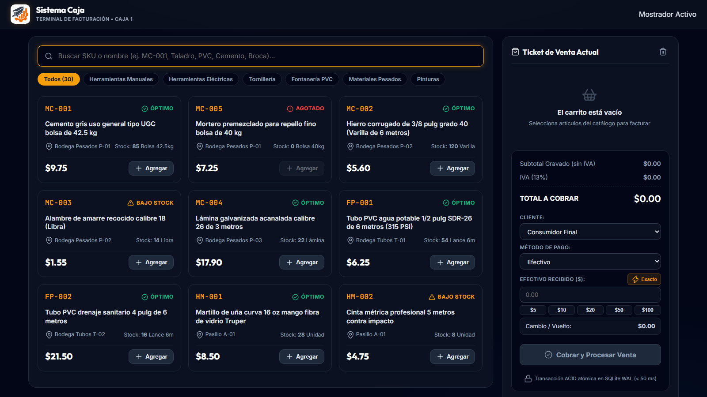 |
| **Fiscal Receipt & Idempotency Token**<br>*UUID transaction confirmation & 13% tax breakdown* | 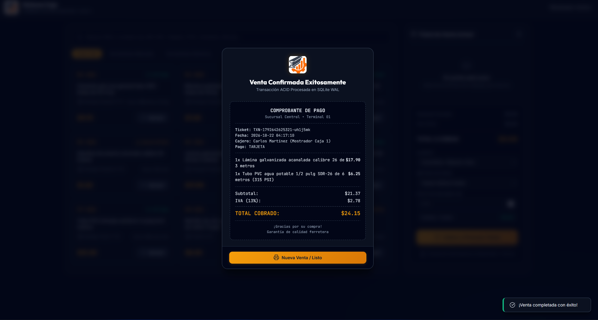 |
| **Warehouse Aisle Audit & ROP Table**<br>*Aisles A–E stock status (`OPTIMAL`, `LOW_STOCK`, `OUT_OF_STOCK`)* | 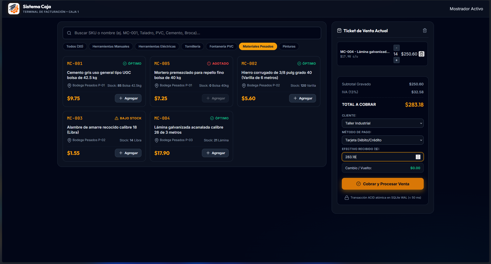 |
| **Looker Studio BI — Page 1**<br>*Daily revenue, gross margin, and category performance* | 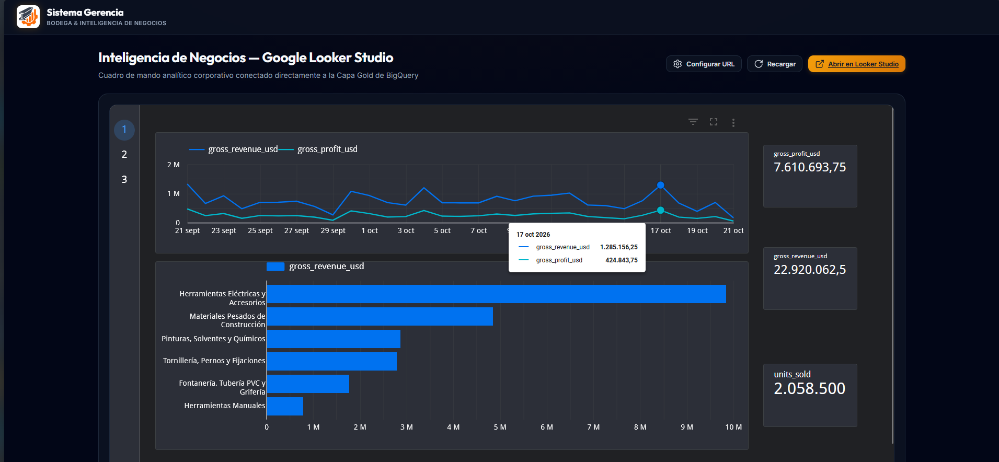 |
| **Looker Studio BI — Page 2**<br>*80/20 Pareto ABC matrix, Daily Burn Rate, and DOI* | 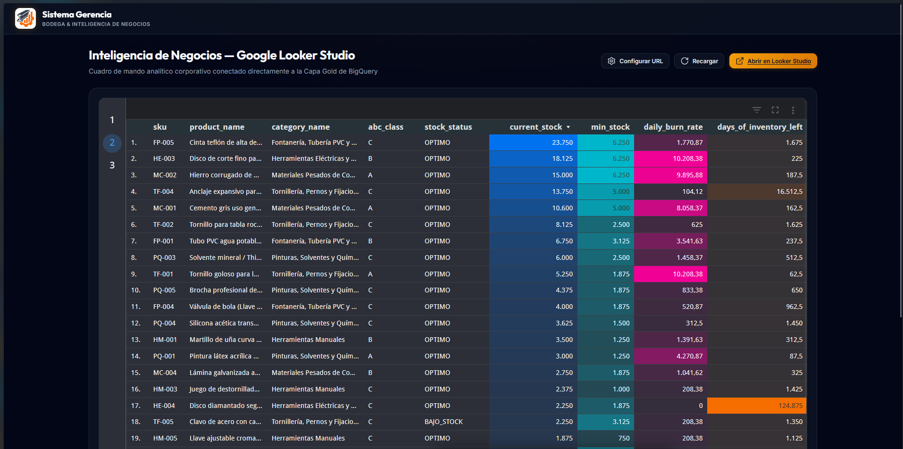 |
| **Looker Studio BI — Page 3**<br>*Working capital valuation by ABC classification* | 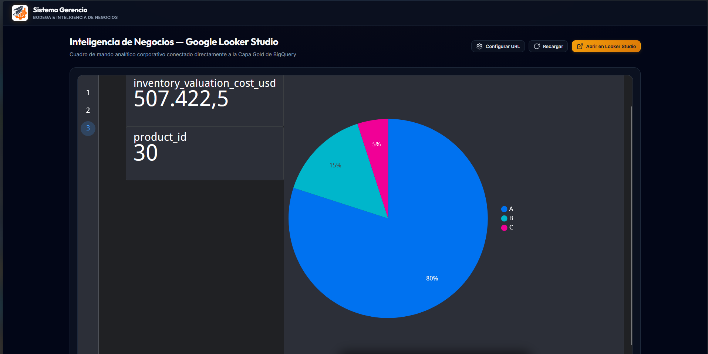 |
| **Google BigQuery Data Warehouse**<br>*`ferrostats_bronze`, `ferrostats_silver`, and `ferrostats_gold`* | 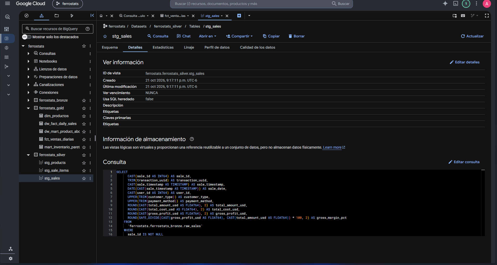 |
| **Google Cloud Dataform Pipeline**<br>*Declarative SQLX DAG and Data Quality assertions* | 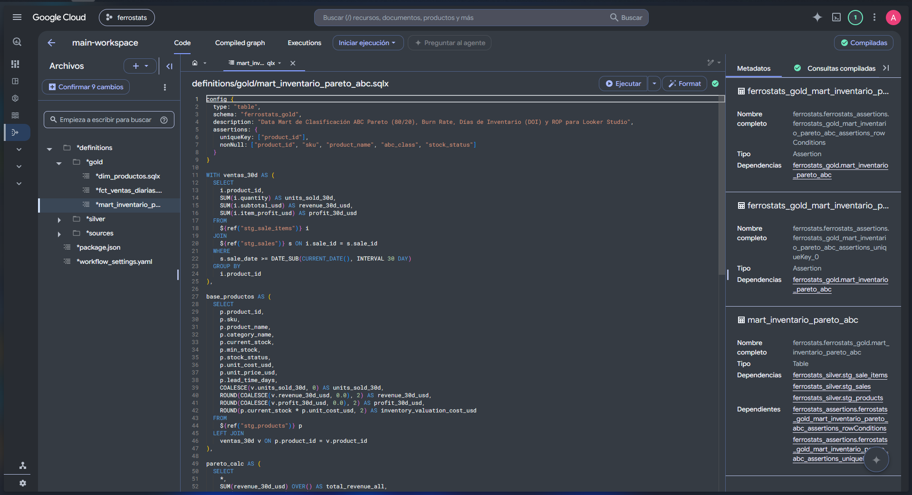 |

---

## 8. Repository Structure

```text
ferrostats/
├── dataform/                      # Google Cloud Dataform Medallion Pipeline (SQLX)
│   ├── definitions/
│   │   ├── sources/               # BigQuery Bronze source declarations (sources.js)
│   │   ├── silver/                # Curated Silver views & DQ assertions (stg_sales, stg_sale_items, stg_products)
│   │   └── gold/                  # Gold Star Schema marts (fct_daily_sales, mart_inventory_pareto_abc, dim_products)
│   ├── package.json               # Dataform dependency configuration
│   └── workflow_settings.yaml     # GCP project (ferrostats) and dataset defaults
├── app/
│   ├── etl/
│   │   ├── bigquery_sync.py       # Asynchronous REST streaming client into BigQuery Bronze
│   │   └── local_pipeline.py      # Local Star Schema compiler & 6 Data Quality assertions
│   ├── db/
│   │   ├── connection.py          # SQLite WAL connection manager & PRAGMA tuning
│   │   ├── schema_oltp.sql        # 3NF transactional database DDL
│   │   ├── schema_olap.sql        # Local Star Schema analytical cache DDL
│   │   └── seed_loader.py         # Deterministic synthetic generator (180 sales, 30 English SKUs)
│   ├── api/
│   │   ├── auth_rbac.py           # Header-based role simulation (X-User-Role)
│   │   ├── routes_analytics.py    # BI KPIs, Pareto marts, and Dataform observability endpoints
│   │   ├── routes_inventory.py    # Warehouse aisle adjustments & Bronze movement streaming
│   │   └── routes_pos.py          # Atomic ACID checkout with guarded stock decrements & UUID idempotency
│   ├── static/                    # SDD Edge Event Producer Web Interfaces (SPA)
│   │   ├── index.html             # Warehouse aisle audit & embedded Looker Studio BI portal
│   │   ├── app.js                 # Warehouse adjustment & Looker Studio sync logic
│   │   ├── pos.html               # Cashier POS checkout simulator
│   │   ├── pos.js                 # Cart state, change calculator & receipt renderer
│   │   └── styles.css             # Slate industrial dark theme
│   ├── config.py                  # Environment & GCP dataset configuration
│   └── main.py                    # FastAPI application entrypoint
├── data/
│   ├── db/                        # Local SQLite WAL mount point (.gitignore protected)
│   └── seeds/                     # Master English CSV seeds (products_sku, categories, suppliers, users)
├── scripts/
│   ├── sync_sqlite_to_bigquery.py # Full Bronze batch synchronization (SQLite -> BigQuery Bronze)
│   ├── deploy_dataform_models.py  # Compiles Silver views & Gold Star Schema tables in BigQuery
│   ├── sync_dataform_to_gcp.py    # Uploads local SQLX files to GCP Dataform workspace via REST API
│   ├── smoke_test.py              # End-to-end HTTP & UUID idempotency verification suite
│   ├── verify_zero_cost.ps1       # Automated GCP FinOps quota & billing auditor
│   └── emergency_kill_switch.ps1  # Instant service scale-down for billing contingencies
├── finops/
│   └── gcp_free_tier_policy.json  # Machine-readable $0.00/mo FinOps guardrails
├── specs/                         # Formal Spec-Driven Development (SDD) Architectural Blueprints (01–07)
├── docs/
│   └── architecture_flow.md       # Mermaid end-to-end data lineage specification
├── assets/                        # Architecture diagrams, presentation deck, and UI screenshots
├── Dockerfile                     # Multi-stage Python 3.11-slim container definition
├── deploy_gcp.ps1                 # Scale-to-zero Cloud Run deployment & Artifact Registry pruning
└── requirements.txt               # Production Python dependencies
```

---

## 9. Local Quickstart & Cloud Synchronization

### 1. Clone and set up virtual environment
```bash
git clone https://github.com/bapatata688/Ferrostats.git
cd Ferrostats
python -m venv .venv

# Windows PowerShell:
.venv\Scripts\Activate.ps1
# Linux / macOS:
source .venv/bin/activate

pip install --no-cache-dir -r requirements.txt
```

### 2. Initialize deterministic English seeds & run local Star Schema ETL
```bash
python -m app.db.seed_loader
```

### 3. Launch the local server & run smoke tests
```bash
python -m uvicorn app.main:app --host 0.0.0.0 --port 8080 --reload
```
In a second terminal, verify all endpoints and UUID idempotency replay:
```bash
python scripts/smoke_test.py
```

### 4. Synchronize Bronze, Silver & Gold layers to Google BigQuery & Dataform
```bash
python scripts/sync_sqlite_to_bigquery.py
python scripts/deploy_dataform_models.py
python scripts/sync_dataform_to_gcp.py
```

---

## 10. Known Limitations & Portfolio Trade-offs

This repository is engineered to demonstrate a production-grade **Data Engineering Lakehouse** within a permanent **$0.00 USD/month FinOps constraint**:
1. **Header-Based Role Simulation vs. Enterprise IAM:** `app/api/auth_rbac.py` simulates roles via the `X-User-Role` HTTP header so reviewers can test all endpoints freely without login barriers. Production deployments would sit behind Google Cloud Identity-Aware Proxy (IAP) or OIDC JWT verification.
2. **Ephemeral Edge Container State vs. Multi-Region OLTP:** Local SQLite WAL state lives inside the scale-to-zero Cloud Run instance (auto-seeded on cold start), while **Google BigQuery** serves as the persistent cloud analytical system of record.

---

## 11. Lead Data Architect & Contact

- **Author & Lead Data Architect:** Diego Alejandro Escobar Barahona
- **Certification:** [Google Cloud Certified — Associate Data Practitioner](https://www.credly.com/badges/e27fea72-5eaf-47ee-a43c-43faa3a8fb10) (Credential ID: `23e3584a246f4c149f26fea03cebcbbb`)
- **LinkedIn:** [linkedin.com/in/diego-escobar-459256394](https://linkedin.com/in/diego-escobar-459256394)
- **Email:** `diegoalejandroescobarahona1@gmail.com`
- **License:** Released under the [MIT License](LICENSE).
