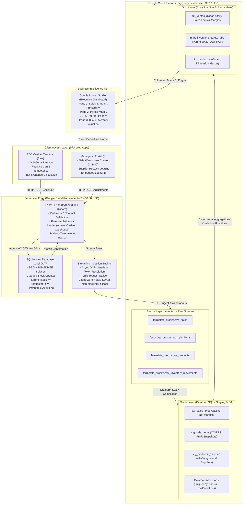

# FERROSTATS — Cloud-Native Business Intelligence & Medallion Data Lakehouse Platform

<p align="center">
  
</p>

<p align="center">
  <strong>Portfolio project: Business Intelligence, Automated Medallion Data Pipeline, and Sub-50ms ACID Point-of-Sale (POS) Engine for Hardware & Construction Retail.</strong>
</p>

<p align="center">
  <a href="https://www.credly.com/badges/e27fea72-5eaf-47ee-a43c-43faa3a8fb10"></a>
  <a href="https://cloud.google.com/run"></a>
  <a href="https://cloud.google.com/bigquery"></a>
  <a href="https://cloud.google.com/dataform"></a>
  <a href="https://lookerstudio.google.com/"></a>
  <a href="finops/gcp_free_tier_policy.json"></a>
  <a href="https://fastapi.tiangolo.com/"></a>
  <a href="https://www.sqlite.org/wal.html"></a>
</p>

<p align="center">
  <strong>Language / Idioma:</strong> <strong>English</strong> | <a href="README.es.md">Versión en Español</a>
</p>

> [!NOTE]
> **Portfolio Project & Synthetic Data:** This is a portfolio demonstration project. All catalog, inventory, and transaction records are synthetically generated using a deterministic seed of 180 transactions to showcase an end-to-end cloud data architecture at zero operational cost ($0.00 USD).

---

## Live Demo Endpoints (Google Cloud Platform)

| Resource | Live Demo URL | Description |
|---|---|---|
| **Executive BI Portal** | [https://ferrostats-bi-platform-s72yk4nsvq-uc.a.run.app](https://ferrostats-bi-platform-s72yk4nsvq-uc.a.run.app) | Real-time managerial portal, warehouse aisle management, and embedded Looker BI. |
| **Point-of-Sale (POS) Terminal** | [https://ferrostats-bi-platform-s72yk4nsvq-uc.a.run.app/pos](https://ferrostats-bi-platform-s72yk4nsvq-uc.a.run.app/pos) | Ultra-fast cashier touch interface with sub-50ms ACID checkout and tax receipts. |
| **Interactive Executive Slides** | [https://ferrostats-bi-platform-s72yk4nsvq-uc.a.run.app/presentacion](https://ferrostats-bi-platform-s72yk4nsvq-uc.a.run.app/presentacion) | Full interactive presentation deck and architectural breakdown. |
| **Looker Studio BI Report** | [Official FERROSTATS Analytics Report](https://datastudio.google.com/reporting/2389e684-fc9b-431d-9c56-487b3067eb87/page/p_dwbfqrtk8d) | Enterprise 3-page BI reporting suite connected natively to BigQuery Gold Marts. |
| **Swagger / OpenAPI 3.0** | [https://ferrostats-bi-platform-s72yk4nsvq-uc.a.run.app/docs](https://ferrostats-bi-platform-s72yk4nsvq-uc.a.run.app/docs) | Interactive REST API documentation and contract definitions. |
| **GCP Project & Dataform** | `ferrostats` (Region: `us-central1`) | Pipeline Repository: `ferrostats-pipeline` on workspace `main-workspace`. |

---

## Spec-Driven Development (SDD) & Architecture Attribution

This enterprise platform was engineered using **Spec-Driven Development (SDD)** with full architectural transparency:

- **Cloud & Data Architecture Ownership:** The entire **Google Cloud Platform (GCP) Data Lakehouse Architecture**, Medallion topologies (Bronze $\to$ Silver $\to$ Gold), BigQuery streaming ingestion protocol, Dataform SQLX pipeline DAGs, $0.00 USD FinOps governance policy, 80/20 Pareto inventory formulation, and transactional ACID isolation rules were designed, authored, and owned by **Diego Alejandro Escobar Barahona** ([Google Cloud Certified — Associate Data Practitioner](https://www.credly.com/badges/e27fea72-5eaf-47ee-a43c-43faa3a8fb10)).
- **Spec-Driven Development (SDD):** Prior to writing implementation code, Diego authored 7 formal architectural specifications ([`specs/spec_01`](specs/spec_01_commit_1_architecture_and_gcp_finops.md) through [`specs/spec_07`](specs/spec_07_commit_7_gcp_serverless_free_tier_production_policy.md)). These specs established formal data contracts, schema invariants, FinOps budget ceilings, ACID concurrency rules, and Data Quality test assertions.
- **AI Pair-Programming Execution:** Autonomous AI pair-programming agents were directed as high-speed implementation copilots to generate the application codebase strictly against Diego's formal specifications, governed by human-in-the-loop technical reviews, deterministic verification scripts (HTTP smoke tests), and Dataform data quality assertions.

### Specifications Traceability Matrix

| Spec | Target Phase & Scope | Architectural Deliverables & GCP Competencies | Status |
|:---:|---|---|:---:|
| [**Spec 01**](specs/spec_01_commit_1_architecture_and_gcp_finops.md) | **System Architecture & FinOps Guardrails** | Hybrid OLTP-ETL-OLAP blueprint, Google Cloud Free Tier budget limits (<$5.00 strict, $0.00 actual), prohibited billable services (Cloud SQL, VPC Connectors). | `Verified` |
| [**Spec 02**](specs/spec_02_commit_2_data_model_and_synthetic_seed.md) | **Data Modeling & Synthetic Seeds** | 3NF Transactional Schema (6 tables), Dimensional Star Schema (Fact + Dimensions), deterministic hardware store synthetic dataset (180 transactions). | `Verified` |
| [**Spec 03**](specs/spec_03_commit_3_etl_pipeline_and_data_quality.md) | **BigQuery Medallion & Data Quality** | Dataform SQLX pipeline (Bronze raw stream $\to$ Silver curated staging $\to$ Gold star marts), automated quality assertions (`uniqueKey`, `nonNull`, row condition checks). | `Verified` |
| [**Spec 04**](specs/spec_04_commit_4_backend_api_and_acid_pos.md) | **FastAPI Backend & ACID POS Engine** | Sub-50ms POS checkout, `BEGIN IMMEDIATE` locks, UUID idempotency, guarded stock decrements (`current_stock >= :qty`), asynchronous BigQuery streaming. | `Verified` |
| [**Spec 05**](specs/spec_05_commit_5_frontend_bi_pos_and_mobile.md) | **Frontend Portals & Embedded BI** | Responsive single-page cashier POS with cash/change calculator, aisle inventory management portal (Aisles A, B, C), and 3-page embedded Looker Studio report. | `Verified` |
| [**Spec 06**](specs/spec_06_commit_6_gcp_deploy_docker_and_qa.md) | **Containerization & GCP Deployment** | Multi-stage `python:3.11-slim` Docker container (~130 MB), scale-to-zero Cloud Run deployment scripts (`deploy_gcp.ps1` / `deploy_gcp.sh`), HTTP smoke test script (`scripts/smoke_test.py`). | `Verified` |
| [**Spec 07**](specs/spec_07_commit_7_gcp_serverless_free_tier_production_policy.md) | **FinOps Governance & Kill-Switch** | Machine-readable FinOps policy (`gcp_free_tier_policy.json`), Artifact Registry image digest purger (<0.5 GB threshold), emergency kill-switch scripts. | `Verified` |

---

## 1. Executive Summary & Problem Space

Traditional hardware stores and regional construction supply distributors operate with significant operational blind spots: manual paper ledgers, fragmented legacy POS systems, and zero analytics. This creates three critical financial bottlenecks:

1. **Unplanned Stockouts on Core Goods (Class A SKUs):** Up to 30% of customer walk-outs occur because staple structural goods (cement, structural rebar, PVC pipes) run out unexpectedly. When customers cannot buy the basics, they purchase their entire bill of materials from competitors.
2. **Trapped Working Capital ("Inventario Hueso"):** Up to 25% of operating capital remains frozen in slow-moving inventory (specialty finishes, niche power tools), choking liquidity needed for fast-turnover purchases.
3. **Transaction Latency & Concurrency Hazards:** Checkout bottlenecks during peak hours, price discrepancies, and inventory overselling across terminals without strict ACID isolation.

**FERROSTATS** solves this challenge through a decoupled, cloud-native architecture:
- **Sub-50ms Transactional POS Engine:** Fast edge cashier terminal running on SQLite Write-Ahead Logging (WAL) with `BEGIN IMMEDIATE` locks, guarded decrements, and UUID idempotency.
- **Physical Warehouse & Aisle Management:** Structural classification by functional aisles (A: Heavy Structural, B: Tools & Hardware, C: Finishes & Plumbing), critical stock alerts, and supplier receipt logging.
- **Google Cloud Medallion Lakehouse:** Asynchronous streaming ingestion into **Google BigQuery**, orchestrated with declarative **Google Dataform SQLX** (Bronze $\to$ Silver $\to$ Gold) with automated Data Quality (DQ) assertions and dynamic **80/20 Pareto classification**.
- **Permanent $0.00 USD/Month FinOps Model:** 100% serverless, zero-cost architecture utilizing Google Cloud's Always Free Tier without managed database recurring fees.

---

## 2. End-to-End System Architecture

<p align="center">
  
</p>



---

## 3. Core Architectural Pillars

### 3.1 Decoupled OLTP Edge & Cloud Lakehouse
- **Ultra-Low Latency (<50ms):** Cashier checkouts execute against local SQLite in **Write-Ahead Logging (WAL)** mode (`PRAGMA journal_mode = WAL`, `PRAGMA synchronous = NORMAL`), avoiding external database roundtrips during physical sales.
- **Strict ACID Isolation & Race Condition Guard:**
  ```python
  cursor.execute("BEGIN IMMEDIATE TRANSACTION;")
  # 1. Check idempotency UUID
  # 2. Check stock availability
  # 3. Guarded atomic decrement:
  cursor.execute("""
      UPDATE products
      SET current_stock = current_stock - ?, updated_at = ?
      WHERE product_id = ? AND current_stock >= ?;
  """, (qty, now_ts, prod_id, qty))
  if cursor.rowcount == 0:
      conn.execute("ROLLBACK;")
      raise HTTPException(status_code=409, detail="Race condition detected. Stock depleted.")
  ```
- **Asynchronous Cloud Ingestion:** Once committed locally, transaction events stream to BigQuery using an ultra-lightweight HTTP client utilizing the Cloud Run internal metadata server for OAuth token minting, eliminating heavy SDK memory bloat.

### 3.2 Medallion Lakehouse Architecture in BigQuery & Dataform

| Layer | BigQuery Dataset | Models / Tables | Technical Purpose |
|---|---|---|---|
| **Bronze** | `ferrostats_bronze` | `raw_sales`<br>`raw_sale_items`<br>`raw_products`<br>`raw_inventory_movements` | Append-only raw event ingestion preserving original transactional integrity and full lineage. |
| **Silver** | `ferrostats_silver` | `stg_sales`<br>`stg_products`<br>`stg_sale_items` | Curated staging views in Dataform SQLX with strict type casting (`INT64`, `FLOAT64`, `TIMESTAMP`), derivation of COGS and net margins. |
| **Gold** | `ferrostats_gold` | `fct_ventas_diarias`<br>`dim_productos`<br>`mart_inventario_pareto_abc` | Dimensional Star Schema marts pre-aggregated for sub-second Looker Studio queries. |

#### Automated Data Quality (Dataform Assertions)
- **`uniqueKey: ["sale_id"]`:** Mathematically guarantees zero duplicate transactions in the warehouse.
- **`nonNull: ["total_amount_usd", "sale_timestamp", "sku"]`:** Rejects incomplete or anomalous records before analytical modeling.
- **`rowConditions`:** Enforces business logic integrity (e.g., `quantity > 0` and `subtotal_usd >= 0` on `stg_sale_items`, `total_amount_usd >= 0` on `stg_sales`, and `current_stock >= 0` on `stg_products`).

---

## 4. Advanced Analytical SQL: 80/20 Pareto & Supply Chain Modeling

The production model `ferrostats_gold.mart_inventario_pareto_abc` calculates real-time supply chain indicators over a 30-day rolling window:

### 4.1 Dynamic Cumulative Pareto 80/20 Formulation
```sql
WITH pareto_calc AS (
  SELECT
    p.*,
    SUM(revenue_30d_usd) OVER() AS total_revenue_all,
    SUM(revenue_30d_usd) OVER(
      ORDER BY revenue_30d_usd DESC, units_sold_30d DESC, product_id ASC
      ROWS BETWEEN UNBOUNDED PRECEDING AND CURRENT ROW
    ) AS running_revenue
  FROM base_productos p
),
pareto_cumulative AS (
  SELECT
    product_id, sku, product_name, category_name, current_stock, min_stock,
    ROUND(SAFE_DIVIDE(running_revenue, NULLIF(total_revenue_all, 0)) * 100.0, 2) AS cumulative_rev_pct
  FROM pareto_calc
)
SELECT
  product_id, sku, product_name, category_name, current_stock, min_stock,
  cumulative_rev_pct,
  CASE
    WHEN cumulative_rev_pct <= 80.0 THEN 'A'
    WHEN cumulative_rev_pct <= 95.0 THEN 'B'
    ELSE 'C'
  END AS abc_class
FROM pareto_cumulative;
```

- **Class A (Core Capital Drivers):** The top ~20% of SKUs generating up to 80% of gross revenue. Prioritized for zero-stockout tolerance.
- **Class B (Moderate Velocity):** Products generating the next 15% of revenue (80% to 95%).
- **Class C (Long Tail / Potential Liquidity Traps):** The bottom ~50% of catalog generating only 5% of revenue.

### 4.2 Dynamic Burn Rate, Days of Inventory (DOI), and Lead-Time ROP
$$\text{Daily Burn Rate} = \frac{\text{Units Sold in 30 Days}}{30.0}$$

$$\text{Days of Inventory Remaining (DOI)} = \frac{\text{Current Stock}}{\text{Daily Burn Rate}}$$

$$\text{Recommended Reorder Quantity} = \max\Big(\text{Min Stock} + \lceil\text{Burn Rate} \times \text{Lead Time}\rceil + \lceil\text{Burn Rate} \times 15\rceil - \text{Current Stock},\; \text{Min Stock},\; 5\Big)$$

Where $\lceil\text{Burn Rate} \times 15\rceil$ serves as an automated dynamic safety buffer.

---

## 5. FinOps Engineering: Permanent $0.00 USD/Month Free Tier

FerroStats operates under a strict **Zero Fixed-Cost Cloud Policy** leveraging Google Cloud's Always Free Tier:

| Service | Always Free Tier Monthly Limit | FERROSTATS Real Consumption | Monthly Cost |
|---|---|---|:---:|
| **Google Cloud Run** | 2,000,000 requests + 360,000 vCPU-seconds | ~15,000 requests (`min-instances = 0`) | **$0.00 USD** |
| **Google BigQuery** | 10 GB active storage + 1 TB queries / month | < 50 MB data + < 25 MB query scan / month | **$0.00 USD** |
| **Google Cloud Storage** | 5 GB standard regional storage (US) | < 50 MB container & deployment artifacts | **$0.00 USD** |
| **Google Dataform** | Free workspaces and pipeline compilations | 1 repository (`ferrostats-pipeline`) | **$0.00 USD** |
| **Google Looker Studio** | Free report creation & BI Engine connector | In-memory cached queries | **$0.00 USD** |
| **Google Artifact Registry** | 0.5 GB container storage / month | Kept < 0.3 GB via automated digest pruning scripts | **$0.00 USD** |
| **Cloud SQL (RDBMS)** | *Avoided (Costs ~$15–$25/mo + public IP fees)* | Replaced by SQLite WAL + BigQuery Streaming | **$0.00 USD** |
| **VPC Serverless Connectors** | *Avoided (Costs ~$14/mo per persistent connector)* | Authenticated via IAM & internal metadata server | **$0.00 USD** |
| **TOTAL BILLED** | — | — | **$0.00 USD** |

---

## 6. Architectural Defense & System Design Q&A

### Q1: Why use SQLite in WAL mode instead of a managed database like Cloud SQL PostgreSQL?
> **Answer:** In retail and distributed environments, zero fixed operating costs are critical. Cloud SQL incurs mandatory recurring billing (~$15–$25/month plus public IPv4 charges) even when idle. By pairing SQLite WAL on Cloud Run edge with serverless BigQuery streaming, we achieve sub-50ms ACID latency, zero network hops during cashier checkout, and 100% free-tier compliance. Analytical queries never contend with transactional cashier threads.

### Q2: How do you prevent inventory overselling under high concurrency?
> **Answer:** We enforce a two-tier locking and validation mechanism:
> 1. `BEGIN IMMEDIATE TRANSACTION` locks database writes before checking product stock, preventing dirty reads across concurrent threads.
> 2. The update uses an atomic SQL guard clause: `UPDATE products SET current_stock = current_stock - :qty WHERE product_id = :id AND current_stock >= :qty;`. If `cursor.rowcount == 0`, concurrent transactions depleted stock, triggering an instant `ROLLBACK` and returning `HTTP 409 Conflict`.
> 3. Each request mandates a client-generated UUID (`transaction_uuid`) as an idempotency key. In this demo implementation, duplicate UUIDs are rejected with `HTTP 409 Conflict` (rather than returning the cached original sale receipt), and BigQuery Bronze streaming ingestion does not pass deterministic row IDs, relying on Silver `uniqueKey` assertions to detect duplicate records.

### Q3: How is the Medallion Architecture structured in Google Dataform?
> **Answer:** Transaction logs stream into immutable raw tables in `ferrostats_bronze`. Google Dataform compiles SQLX models into Directed Acyclic Graphs (DAGs). The **Silver** layer performs schema curation, net margin math, and automated Data Quality assertions (`uniqueKey`, `nonNull`, `rowConditions`). The **Gold** layer aggregates dimensional Star Schema marts (`fct_ventas_diarias`, `mart_inventario_pareto_abc`) consumed by Looker Studio BI Engine.

### Q4: How is Pareto 80/20 calculated dynamically in SQL?
> **Answer:** Rather than hardcoding product categories, we compute cumulative revenue dynamically over a rolling 30-day window using analytical window functions:
> `SUM(revenue_30d_usd) OVER(ORDER BY revenue_30d_usd DESC ROWS BETWEEN UNBOUNDED PRECEDING AND CURRENT ROW)`.
> We divide this running total by `SUM(revenue_30d_usd) OVER()`. Any product contributing to the top 80% is dynamically categorized as Class A, 80% to 95% as Class B, and the remainder as Class C.

---

## 7. Demo Visual Showcase

| Component | Interface Preview |
|---|---|
| **Point-of-Sale (POS) Terminal**<br>*Sub-50ms reactive touch checkout* |  |
| **Fiscal Receipt & ACID Confirmation**<br>*Idempotent transaction token and 13% tax* |  |
| **Physical Warehouse & Aisle Control**<br>*Aisles A, B, C stock and critical alerts* |  |
| **Looker Studio BI — Page 1**<br>*Sales evolution, gross margin, and trends* |  |
| **Looker Studio BI — Page 2**<br>*Pareto 80/20 matrix and DOI burn-rate* |  |
| **Looker Studio BI — Page 3**<br>*Working capital valuation by ABC class* |  |
| **Google BigQuery Data Warehouse**<br>*Bronze, Silver, and Gold datasets* |  |
| **Google Cloud Dataform Pipeline**<br>*SQLX DAG orchestration and assertions* |  |

---

## 8. Repository Structure

```text
ferrostats/
├── app/
│   ├── api/
│   │   ├── auth_rbac.py           # Demo role simulation via X-User-Role header
│   │   ├── routes_analytics.py    # BI KPIs, Pareto analysis, and ELT sync endpoints
│   │   ├── routes_inventory.py    # Physical aisle management and restock logging
│   │   └── routes_pos.py          # Atomic ACID cashier checkout with stock guards
│   ├── db/
│   │   ├── connection.py          # SQLite connection manager (WAL mode & foreign keys)
│   │   ├── schema_oltp.sql        # 3NF transactional database schema
│   │   ├── schema_olap.sql        # Dimensional Star Schema (local analytical cache)
│   │   └── seed_loader.py         # Deterministic seed generator (180 historical sales)
│   ├── etl/
│   │   ├── bigquery_sync.py       # Asynchronous streaming ingestion into BigQuery Bronze
│   │   └── local_pipeline.py      # Self-contained local ETL engine & DQ assertions
│   ├── static/
│   │   ├── app.js                 # Managerial portal & BI dashboard logic
│   │   ├── index.html             # Single-Page Application (Aisle & BI views)
│   │   ├── pos.html               # Cashier touch POS terminal interface
│   │   ├── pos.js                 # Reactive cart, cash calculator, and ticket printer
│   │   └── styles.css             # High-contrast corporate dark theme
│   ├── config.py                  # Project environment variables and metadata
│   └── main.py                    # FastAPI application, lifespan cycle, and routing
├── assets/
│   ├── capturas/                  # Architecture diagrams and production UI screenshots
│   ├── logo.png                   # Official FERROSTATS branding
│   └── presentacion_ejecutiva_ferrostats.html # Interactive executive presentation deck
├── data/
│   ├── db/                        # Persistent database mount point (.gitignore protected)
│   └── seeds/                     # Master CSV seeds (products, categories, suppliers, users)
├── dataform/
│   ├── definitions/
│   │   ├── sources/               # External source declarations for BigQuery Bronze
│   │   ├── silver/                # SQLX models for staging and Data Quality assertions
│   │   └── gold/                  # Dimensional Star Schema data marts (Pareto, facts)
│   ├── package.json               # Dataform dependency configuration
│   └── workflow_settings.yaml     # GCP project and dataset default parameters
├── docs/
│   └── architecture_flow.md       # Mermaid architectural flow specification
├── finops/
│   └── gcp_free_tier_policy.json  # Machine-readable FinOps guardrails & zero-cost policy
├── scripts/
│   ├── deploy_dataform_models.py  # Automated deployment of Silver/Gold models to BigQuery
│   ├── emergency_kill_switch.ps1  # Instant service shutdown script for billing emergencies
│   ├── emergency_kill_switch.sh   # Bash equivalent of billing kill-switch
│   ├── sync_dataform_to_gcp.py    # Sync local SQLX files to GCP Dataform workspace
│   ├── sync_sqlite_to_bigquery.py # REST batch synchronization engine (SQLite to BigQuery)
│   ├── verify_zero_cost.ps1       # Automated Cloud Billing verification script
│   ├── verify_zero_cost.sh        # Bash verification script
│   └── smoke_test.py              # HTTP smoke test script
├── specs/                         # Complete Spec-Driven Development (SDD) Blueprints
│   ├── spec_01_commit_1_architecture_and_gcp_finops.md
│   ├── spec_02_commit_2_data_model_and_synthetic_seed.md
│   ├── spec_03_commit_3_etl_pipeline_and_data_quality.md
│   ├── spec_04_commit_4_backend_api_and_acid_pos.md
│   ├── spec_05_commit_5_frontend_bi_pos_and_mobile.md
│   ├── spec_06_commit_6_gcp_deploy_docker_and_qa.md
│   └── spec_07_commit_7_gcp_serverless_free_tier_production_policy.md
├── Dockerfile                     # Multi-stage Python 3.11-slim container definition
├── deploy_gcp.ps1                 # Automated deployment script for Windows PowerShell
├── deploy_gcp.sh                  # Automated deployment script for Linux/macOS Bash
├── requirements.txt               # Production Python runtime dependencies
└── LICENSE                        # MIT Open Source License
```

---

## 9. Local Development Quickstart

### Prerequisites
- Python 3.11+
- PowerShell, Bash, or Zsh terminal
- Google Cloud SDK (`gcloud`) *(optional for local development, required for cloud deployment)*

### 1. Clone the repository
```bash
git clone https://github.com/bapatata688/Ferrostats.git
cd Ferrostats
```

### 2. Set up virtual environment
```bash
python -m venv .venv

# On Windows (PowerShell):
.venv\Scripts\Activate.ps1

# On Linux/macOS:
source .venv/bin/activate
```

### 3. Install dependencies
```bash
pip install --no-cache-dir -r requirements.txt
```

### 4. Run the application
```bash
python -m uvicorn app.main:app --host 0.0.0.0 --port 8080 --reload
```
Open your browser at:
- **Managerial Dashboard:** [http://localhost:8080](http://localhost:8080)
- **POS Cashier Terminal:** [http://localhost:8080/pos](http://localhost:8080/pos)
- **Interactive OpenAPI Docs:** [http://localhost:8080/docs](http://localhost:8080/docs)

---

## 10. Cloud Deployment (Google Cloud Run)

### Windows PowerShell:
```powershell
.\deploy_gcp.ps1 -ProjectId "ferrostats" -Region "us-central1"
```

### Linux / macOS Bash:
```bash
chmod +x deploy_gcp.sh
./deploy_gcp.sh ferrostats us-central1
```

The script automatically:
1. Enables required serverless APIs (`run.googleapis.com`, `cloudbuild.googleapis.com`, `artifactregistry.googleapis.com`).
2. Builds and deploys the container with strict scale-to-zero flags (`--min-instances 0`, `--max-instances 2`, `--memory 512Mi`, `--cpu 1`).
3. Queries Artifact Registry and purges older image digests to enforce the free storage threshold (<0.5 GB).
4. Outputs the public live demo URL.

---

## 11. Known Limitations & Engineering Trade-offs

This project is a portfolio prototype designed to demonstrate an end-to-end cloud data architecture within a strict $0.00 USD FinOps budget. As such, deliberate engineering trade-offs and simplifications exist:

1. **Role Simulation vs. Enterprise Authentication:**
   - The RBAC module (`app/api/auth_rbac.py`) performs role simulation via the HTTP header `X-User-Role` (defaulting to `ADMIN` when omitted), and Cloud Run is deployed with `--allow-unauthenticated`. It is a demo mechanism, not authentication.
   - A production enterprise deployment would enforce identity via Google Cloud Identity-Aware Proxy (IAP), an enterprise OIDC identity provider, or cryptographically signed JWT bearer tokens.
   - Demo seed records in `data/seeds/users.csv` store passwords/PINs as plaintext strings in the `pin` column (explicitly treated as demo testing credentials).
2. **POS Idempotency & Replay Semantics:**
   - In `app/api/routes_pos.py`, submitting a previously processed `transaction_uuid` triggers an `HTTP 409 Conflict` error rather than replaying the original sale receipt representation (`200 OK` with an `Idempotent-Replay: true` header).
3. **BigQuery Streaming Ingestion Deduplication:**
   - In `app/etl/bigquery_sync.py`, `insert_rows_json` does not supply deterministic `row_ids` (e.g., `sale_id`). Network retries can therefore introduce duplicate rows into Bronze raw tables (`raw_sales`, `raw_sale_items`).
   - The Dataform Silver layer assertion `uniqueKey: ["sale_id"]` alerts on duplicate records during QA compilation, but does not self-heal without explicit window deduplication (`QUALIFY ROW_NUMBER() OVER (PARTITION BY sale_id ORDER BY ...) = 1`).

---

## 12. Lead Architect & Contact

- **Lead Architect & Engineer:** Diego Alejandro Escobar Barahona
- **Certification:** [Google Cloud Certified — Associate Data Practitioner](https://www.credly.com/badges/e27fea72-5eaf-47ee-a43c-43faa3a8fb10) (Credential ID: `23e3584a246f4c149f26fea03cebcbbb`)
- **LinkedIn:** [linkedin.com/in/diego-escobar-459256394](https://linkedin.com/in/diego-escobar-459256394)
- **Email:** `diegoalejandroescobarahona1@gmail.com`
- **License:** Released under the [MIT License](LICENSE).
